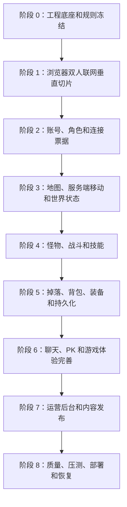

# Web Legend —— MVP 开发计划

> 文档类型：Codex 实施计划（Implementation Plan）  
> 版本：2.0  
> 状态：供 Codex 按阶段执行  
> 基准日期：2026-11-24  
> 配套文档：`WEB_LEGEND_TECHNICAL_ARCHITECTURE_v2.md`

---

## 0. 执行原则

这不是一次性生成完整 MMORPG 的任务。Codex 必须按里程碑开发，每个阶段都有可运行产品、自动化测试和人工可检查证据。

**研发顺序的核心变化：先验证浏览器 + 真正多人联机，再扩展身份、战斗、资产和运营能力。** 不要先花大量时间搭建空壳服务，也不要先做完整单机游戏再改造成联网游戏。

研发优先级：

1. 浏览器能运行一张地图；
2. 两个浏览器用户能在同一个服务端 Room 中互相看见并移动；
3. 角色身份和持久化可靠；
4. 服务端移动、碰撞和怪物模拟可靠；
5. 完成击杀、经验、掉落、拾取、装备、金币的真实闭环；
6. 完成基本聊天和 PK；
7. 后台能管理玩家、地图、内容和发布；
8. 完成压测、部署、回滚和故障恢复。

---

## 1. MVP 产品验收定义

### 1.1 一句话验收标准

玩家打开 URL → 登录 → 创建角色 → 进入主城 → 看到其他玩家 → 进入野外 → 点击移动 → 攻击怪物 → 获得经验、金币或装备 → 拾取并装备 → 和其他玩家聊天、基础 PK → 退出重登后角色和核心资产仍然存在；管理员可以查询玩家和 Room、执行有审计的运营操作、修改游戏数值并发布/回滚内容。

### 1.2 MVP 产品范围

| 模块 | MVP 必须实现 | 暂不纳入 |
|---|---|---|
| 客户端 | PC 浏览器；React UI + Phaser 画面；全屏和基础自适应 | 原生 App、Godot 客户端、完整移动端控制 |
| 画面 | 2D 斜 45° / 伪等距；统一 Sprite 和地图风格 | 3D 场景、骨骼动画系统、物理破坏 |
| 世界 | 1 个 Realm、1 张主城、1 张野外 | 跨服、多城、多层迷宫 |
| 职业 | 战士、法师、道士；每个职业至少 1 个基础主动技能 | 转职、天赋树、复杂职业分支 |
| 怪物 | 2 种基础怪物，刷新/追击/攻击/死亡/重刷 | 多阶段 Boss、复杂行为树 |
| 战斗 | 普攻、技能、伤害、冷却、受击、死亡、复活 | 连招、竞技匹配、大规模团战 |
| 社交 | 同图聊天、玩家可见、基础玩家信息 | 公会、好友、语音、邮件 |
| 经济 | 经验、金币、装备/消耗品掉落、拾取、装备 | 交易行、摆摊、拍卖、复杂词条市场 |
| PK | 主城安全区禁 PK；野外基础 PK | 红名、爆装、罪恶值和复杂惩罚 |
| 持久化 | 账号、角色、等级、经验、背包、装备、金币 | 仓库、邮件、跨区转移 |
| 后台 | Overview、Players、Rooms、Content、Release、Audit | 完整 BI、自动经济调控、AI 自动操作 |
| AI 助手 | 非 MVP 门禁；后续只读诊断 | AI 自主改配置、发装备或处罚玩家 |

### 1.3 MVP 初始容量目标

- 一个地图实例 30 人稳定在线；
- 一个地图实例 50 人持续 10 分钟压力测试；
- 服务端模拟 20Hz，状态同步初始 10Hz；
- 两个独立 Browser Context 可完整联机；
- 所有关键资产操作事务化、幂等化；
- 已提交的物品、金币和经验不会因 Game Server 重启丢失；
- 后台写操作 100% 记录审计；
- 内容可以编辑、校验、发布、激活和回滚。

容量目标必须在固定机器规格和网络条件下实测，不允许仅凭 Room 数或 CPU 推算在线上限。

---

## 2. 研发阶段总览



允许同阶段内按模块并行，但不允许跨越阶段门禁并行堆叠功能。

---

## 3. 阶段 0：工程底座和规则冻结

**目标：** 建立可复现工程，锁定关键技术和代码边界；不做假游戏功能。

### 任务

1. 检查本机 Node.js、pnpm、Docker 和 Git 环境。
2. 创建 pnpm workspace Monorepo。
3. 创建 `game-web`、`admin-web`、`control-api`、`game-server` 四个 app 的最小启动入口。
4. 建立 `contracts`、`content-schema`、`game-domain`、`game-simulation`、`game-application`、`persistence`、`map-runtime`、`auth`、`observability`、`config`、`testkit` 包。
5. 建立 TypeScript strict、ESLint、Prettier、Vitest、Playwright 和 import boundary 检查。
6. 使用 Node.js 26 LTS；初始化时复核 Phaser、Colyseus、Fastify、Drizzle 等包的 Node engine 要求。
7. Docker Compose 先启动 PostgreSQL 18.x；Redis 作为 `scale` profile，可后续启用。
8. 配置 Drizzle migrations、Zod 环境变量校验、Pino logger 和 health endpoint。
9. 建立根目录 `AGENTS.md`、README、ADR 模板和 `.env.example`。
10. 阅读并核对当前 Colyseus 0.18 API，使用最小 Room / reconnect 测试验证实际版本行为。

### 验收标准

- 新环境按 README 能启动本地数据库和全部 app；
- `pnpm lint`、`pnpm typecheck`、`pnpm test`、`pnpm build` 通过；
- migration 可在空数据库执行；
- 无密钥进入 Git；
- 依赖边界检查能阻止 game-web 导入 persistence；
- 目录内没有为“看起来完整”而创建的大量空壳 Service。

**阶段交付：** 工程目录树、依赖版本、启动方式、测试记录、ADR-001 至 ADR-012 的实施状态。

---

## 4. 阶段 1：浏览器双人联网垂直切片

**目标：** 第一时间验证 Phaser + Colyseus + WebSocket + 浏览器渲染链路。此阶段不做正式账号和持久化资产。

### 任务

1. Phaser bootstrap、Scene 生命周期、React HUD overlay。
2. 建立一张小型测试地图和最基础的角色 Sprite；先保证脚底锚点和深度排序正确。
3. 创建一个 `world_map` Colyseus Room。
4. 开发环境临时身份允许两个浏览器加入同一 Room；该身份只能在 `NODE_ENV=development` 使用。
5. 服务端维护两个玩家的权威位置和方向。
6. 实现最小 `move.to` 输入、服务器位置校正和远端插值。
7. 实现简单地图边界，防止角色移出地图。
8. 两个浏览器都显示在线玩家列表和对方角色。
9. 建立基本网络断开提示和重新加入按钮。

### 验收标准

- 两个独立 Chrome Browser Context 可进入同一个 Room；
- A 移动时 B 能在 250ms 内看到状态变化（固定测试网络下）；
- 客户端无法通过伪造 payload 直接设置服务器位置；
- 页面刷新/断网后能显示明确状态，Room 存活时可以正常重连；
- Phaser Scene 重启不产生重复事件和输入监听；
- 无数据库、登录、背包和战斗的假实现混入正式模块。

**阶段交付：** 双浏览器联机演示、WebSocket 日志、Room 状态截图和自动化测试。

---

## 5. 阶段 2：账号、角色和连接票据

**目标：** 让真实玩家身份进入多人世界，并建立稳定角色归属。

### 任务

1. 注册、登录、刷新、登出和会话撤销。
2. 密码 Argon2id；Refresh Token hash 存储并支持轮换。
3. 建立 Account、Realm、Character 表和 migrations。
4. 创建角色：选择职业、名称、初始属性、初始地图和出生点。
5. Realm 内角色名唯一，明确大小写归一规则。
6. 实现角色列表、选择角色和进入游戏 ticket。
7. Ticket 短时、绑定 account/character/realm，并只能消费一次。
8. Game Server 在 Colyseus `onAuth` / join 阶段校验 ticket，不接受客户端自报角色 ID。
9. 建立角色单活跃 Session lease，处理重复登录和异常掉线。
10. 建立玩家资料读取 API 和角色所有权检查。

### 验收标准

- 未登录用户不能进入正式 Room；
- 玩家不能读取或控制其他账号角色；
- 过期、撤销或重复消费的 ticket 不能建立连接；
- 同 Realm 角色名不能重复；
- 同一个角色不会被两个客户端同时控制；
- API 和数据库重启后角色仍可读取。

---

## 6. 阶段 3：正式地图、服务端移动和世界状态

**目标：** 建立第一版真实世界和地图运行时。

### 任务

1. Tiled 创建 `starter_town` 和 `starter_wilds`。
2. 建立 MapRuntimeManifest 编译脚本：碰撞、导航、出生点、刷怪点、传送点、NPC 点。
3. Phaser 加载地图、tileset、角色 Sprite 和资源 manifest。
4. 实现脚底锚点、Y-sort、地图遮挡层和摄像机跟随。
5. 实现点击移动、路径预览、服务端寻路、速度和碰撞验证。
6. 加入 `MapTemplate`、`MapInstance` 和 Room 固定映射关系。
7. 实现主城到野外传送和坐标恢复。
8. 实现 AOI 基础模块：地图按网格 cell 分区，客户端只接收相关实体。
9. 实现同图玩家可见和玩家状态更新。
10. 实现正常断线 grace period、重连和离开清理。
11. 建立角色位置/HP/MP checkpoint 策略。
12. 实现同地图基础聊天，服务端限频和长度限制。

### 验收标准

- Tiled 地图中的碰撞与服务器导航结果一致；
- 玩家无法穿墙、超速或传送到非法坐标；
- 主城和野外传送过程不会重复生成角色实体；
- 玩家离开 Room 后释放 AOI 订阅和资源；
- Room 重启后角色能从 PostgreSQL 恢复；
- 至少 30 个虚拟用户可以加入地图并移动，tick 指标可观测。

---

## 7. 阶段 4：怪物、战斗和技能

**目标：** 完成第一条服务端权威 PvE 成长链路；优先战士，再补法师和道士。

### 任务

1. 建立 Combat 纯领域函数：命中、伤害、暴击、抗性、冷却、资源消耗。
2. 建立 Monster 定义、刷怪点、刷新周期、仇恨和简单 FSM。
3. 怪物状态：`idle → patrol → chase → attack → return → dead`。
4. 完成战士普攻和一个主动技能。
5. 完成法师、道士基础技能配置；每职业至少 1 个基础技能。
6. 实现目标选择、攻击距离、攻击间隔和技能释放反馈。
7. 实现服务器 RNG 注入，测试使用可控 RNG。
8. 生成 CombatEvent，客户端播放动作、受击、伤害数字和音效。
9. 实现怪物死亡和刷新。
10. 记录用于测试的 combat replay fixture 或战斗事件摘要。

### 验收标准

- 客户端不能伪造伤害、暴击、冷却、怪物死亡和经验；
- 两人同时攻击同一怪物时只有一个权威 HP；
- 服务器关闭后不能继续由客户端生成战斗结果；
- 技能冷却和资源由服务器裁定；
- 同一 seed 和相同输入在测试环境能得到确定结果；
- 怪物刷新、追击、攻击和死亡过程能在两个浏览器中一致观察。

---

## 8. 阶段 5：掉落、背包、装备和资产持久化

**目标：** 完成传奇类游戏最重要的“击杀—掉落—拾取—穿戴—成长”闭环。

### 任务

1. 建立 Item Template、Item Instance、Stack、Equipment Slot。
2. 建立背包格子和装备槽位。
3. 建立 2 种怪物掉落表。
4. 建立地面掉落实例、拾取范围、归属规则和过期机制。
5. 建立钱包 Wallet 和 Currency Ledger。
6. 击杀奖励、掉落、拾取、使用消耗、装备转移全部使用事务和幂等键。
7. 对并发拾取使用数据库行锁或唯一约束，不能仅在内存判断。
8. 角色属性由服务端根据等级、基础属性、装备和状态效果计算。
9. 实现角色成长、升级反馈和持久化。
10. 关键资产操作提交后再发客户端 ACK。
11. checkpoint 角色位置、HP/MP 和非关键瞬时状态。
12. 编写进程异常退出、重复命令、重登和资产一致性测试。

### 验收标准

- 两人同时拾取同一 drop，最多一个成功；
- 一个 Item Instance 不能同时出现在地面和背包；
- 装备槽唯一且职业限制有效；
- 金币余额和流水一致；
- 重试发奖、拾取或装备命令不会重复执行；
- Game Server 重启后已提交的角色经验、物品、装备和金币保持一致；
- 任何持久化失败都不能给玩家显示成功奖励。

---

## 9. 阶段 6：聊天、PK 和游戏体验完善

**目标：** 形成足够接近经典传奇体验的多人互动闭环。

### 任务

1. 完成安全区规则：主城禁止 PK，野外允许基础 PK。
2. 玩家战斗目标验证、伤害和死亡由服务端判定。
3. 实现死亡状态、复活倒计时和复活点。
4. MVP 不做红名、爆装、复杂罪恶值和死亡惩罚。
5. 完成同图聊天：限频、长度限制、过滤接口和系统消息。
6. 完善玩家头顶名称、HP 条、目标框和攻击反馈。
7. 完善背包、装备、角色面板、技能栏和小地图。
8. 统一音效和 UI 反馈，补齐加载、断线、重连和错误状态。
9. 对主城、野外、三职业、两种怪物和基础战斗做美术一致性评审。

### 验收标准

- 主城 PK 请求一定被服务器拒绝；
- 野外基础 PK 能完成伤害、死亡和复活；
- 客户端不能通过伪造区域或坐标绕过安全区规则；
- 聊天不能绕过服务端限频；
- 背包、装备、聊天、目标框和角色 HUD 不遮挡主要战斗区域；
- 连续游玩 20 分钟无明显内存泄漏、输入失灵和 Scene 重复监听。

---

## 10. 阶段 7：运营后台和内容发布

**目标：** 让项目从“开发者能玩”变成“运营人员可以管理和更新”。

### 任务

#### 10.1 后台基础

1. 管理员登录和服务端 RBAC；
2. 管理员身份和玩家账号身份分离；
3. Overview：在线人数、Room 数、Game Server 健康、tick p95、API/DB 健康；
4. Players：账号、角色、等级、装备、背包、地图和在线状态查询；
5. Rooms：Realm、Map、Instance、Room ID、Game Server ID、人数和 tick 状态；
6. Audit：按 actor、action、target、reason、时间和结果搜索。

#### 10.2 运营指令

1. 踢下线、封禁、禁言；
2. 每个写操作都需要原因；
3. 使用 PostgreSQL Outbox；
4. Game Server 按 commandId 幂等执行；
5. 后台展示 `pending / dispatched / applied / failed`。

#### 10.3 内容管理

1. Draft 编辑：职业、技能、怪物、物品和掉落表；
2. Schema 校验；
3. 引用、数值范围、概率、资源和地图坐标校验；
4. 内容差异预览；
5. 生成不可变 Content Release；
6. 按 Realm 激活；
7. 新 Room 使用新版本，旧 Room 保留创建时的版本；
8. 支持切回上一 Release；
9. 记录发布人、审批人、时间、checksum 和变更原因。

#### 10.4 后台审美要求

- 采用信息密度适中、颜色克制的专业运营工作台；
- 不使用默认 Ant Design 模板直接交付；
- 数据表支持服务器端分页、排序和筛选；
- 发布状态和风险级别一目了然；
- 危险操作显示目标和影响范围，并要求输入原因；
- Overview 先呈现异常，不堆叠装饰性指标卡。

### 验收标准

- 未授权用户不能通过直接 API 调用执行后台操作；
- 每个成功和失败的后台写操作都有审计记录；
- Kick/Ban/Mute 命令能可靠到达目标 Game Server，并且重复投递不重复执行；
- 非法内容不能发布；
- 发布后新 Room 使用新版本，已有 Room 仍使用旧版本；
- 回滚后新 Room 使用上一版本；
- 后台无法执行任意 SQL 或任意 JavaScript。

---

## 11. 阶段 8：质量、压测、部署和恢复

**目标：** 证明项目不只是开发机器上能跑，而是可部署、可观测、可恢复。

### 任务

1. 建立生产 Docker 镜像、多环境配置和部署脚本。
2. 配置 HTTPS/WSS、CORS/Origin allowlist、Rate Limit 和 payload limits。
3. 配置结构化日志、Prometheus metrics 和关键告警。
4. Playwright 多浏览器 E2E。
5. 建立 Colyseus Room 压测或专用 WebSocket 模拟客户端。
6. 场景：30 个玩家持续移动，10 个玩家周期性攻击，地图内 20–40 个怪物，持续至少 10 分钟；另以 50 玩家进行短时压力测试。
7. 记录 tick p50/p95/p99、事件循环延迟、CPU/RSS、GC、WS bytes、patch bytes、DB transaction p95、重连率和命令拒绝率。
8. 建立 PostgreSQL 备份和恢复演练。
9. 演练 Game Server 正常重启、非正常退出、断网、DB 暂时不可用和 Outbox 重试。
10. 编写发布、回滚、Room drain、内容回滚和数据库恢复 runbook。

### 验收标准

- 固定机器规格下达到 MVP 容量指标；
- 压测期间没有重复发放或永久丢失物品/金币；
- Game Server 崩溃后玩家可以重新入图，已提交资产正确；
- 数据库备份至少完成一次实际恢复；
- 代码发布和内容发布可以分别回滚；
- 能通过指标定位 Room tick 慢、DB 慢和 Outbox 积压。

---

## 12. MVP 初始内容清单

### 12.1 地图

| Map ID | 类型 | 功能 |
|---|---|---|
| `starter_town` | 主城 | 出生、安全区、其他玩家、聊天、补给 NPC 占位 |
| `starter_wilds` | 野外 | 怪物刷新、战斗、掉落和基础 PK |

### 12.2 职业

| Class ID | 定位 | MVP 技能 |
|---|---|---|
| `warrior` | 近战、高韧性 | `slash` |
| `mage` | 远程法术 | `fire_bolt` |
| `taoist` | 持续伤害/辅助 | `poison_mark` 或基础治疗 |

先完成战士完整链路，再把法师和道士接入已验证的技能 Effect DSL；不得为三个职业复制三套战斗系统。

### 12.3 怪物

| Monster ID | 行为 |
|---|---|
| `wild_slime` | 低威胁近战，用于移动和攻击验证 |
| `forest_wolf` | 主动追击，验证仇恨和返回行为 |

### 12.4 道具

- 3 种基础职业武器；
- 2–3 件基础防具；
- 1–2 种药水；
- 金币；
- 少量普通怪物材料。

MVP 不做大量装备词条；重点验证模板、实例、归属、堆叠、穿戴和存档。

---

## 13. MVP 实时协议清单

### Client → Server

- `move.to`
- `combat.basicAttack`
- `skill.cast`
- `loot.pickup`
- `inventory.use`
- `inventory.equip`
- `inventory.unequip`
- `chat.send`
- `player.ping`

### Server → Client

- Colyseus state patches：玩家、怪物、地面掉落和公开地图状态；
- `command.ack` / `command.rejected`；
- `combat.hit` / `combat.miss` / `combat.death`；
- `loot.spawned` / `loot.claimed`；
- `inventory.updated`；
- `character.stats.updated`；
- `chat.message`；
- `system.notice`；
- `session.kicked` / `session.expiring`。

每个消息都有 schema、最大长度/数值范围、权限检查、频率限制和错误码测试。

---

## 14. 测试矩阵

### 14.1 单元测试

- 移动速度上限、碰撞、寻路不可达；
- 攻击距离、攻击频率、冷却和资源消耗；
- 伤害、暴击、抗性边界；
- RNG 和掉落分布；
- 背包容量、堆叠、装备槽；
- 钱包余额和账本一致；
- 命令幂等；
- 角色会话互斥；
- 后台 RBAC。

### 14.2 集成测试

- PostgreSQL 事务回滚；
- 并发拾取同一 world drop；
- 角色创建和角色名唯一；
- Game Ticket 创建、消费、过期和重复消费；
- Colyseus Room join/leave/reconnect；
- Outbox 重试和重复消费；
- Content Release 创建、激活和回滚；
- 管理命令到 Room 的执行回执。

### 14.3 Playwright E2E

必须覆盖：

1. 注册/登录/创建角色/选择角色；
2. 两个独立 Browser Context 同图移动和可见；
3. 地图碰撞和传送；
4. 怪物战斗、掉落、拾取和装备；
5. 退出重登后资产恢复；
6. 同图聊天和安全区 PK 规则；
7. 后台搜索玩家、Kick 并检查审计；
8. 修改掉落配置、校验、发布和回滚；
9. WebSocket 断开后重连；
10. Game Server 进程重启后重新获取票据并恢复角色。

### 14.4 负载测试

- 30 玩家持续移动；
- 10 玩家周期性攻击；
- 20–40 怪物；
- 持续 10 分钟；
- 再做 50 玩家短时压力测试。

不得将“连接成功”当成容量测试通过；必须持续移动、战斗和广播状态。

---

## 15. Codex 协作策略

### 15.1 角色分工

只有在接口和任务边界确定后再并行派发。初期由一个主 Agent 维护接口和集成。

| Agent | 职责 | 修改边界 |
|---|---|---|
| Architect / Integrator | 架构、contracts、ADR、集成和门禁 | `docs/`、`AGENTS.md`、跨模块接口 |
| Client Agent | Phaser、React HUD、资源管线 | `apps/game-web/`、客户端包 |
| Server Agent | Colyseus、Room、状态同步和 AOI | `apps/game-server/` |
| Domain / Persistence Agent | 领域逻辑、事务、Schema 和迁移 | `packages/game-domain/`、`game-application/`、`persistence/` |
| Admin Agent | 后台页面、内容编辑和发布界面 | `apps/admin-web/` |
| QA Agent | 测试、E2E、负载和恢复演练 | `tests/`、`testkit/`、测试脚本 |

### 15.2 协作规则

- Architect 先定义 contracts、schema 和验收标准，再派发任务；
- 多 Agent 不得同时修改同一 migration、公共 DTO 或同一个 Room 核心文件；
- 共享接口变化由 Architect 统一合并；
- 每个 Agent 提交前运行受影响模块测试和类型检查；
- QA 必须提供测试命令、结果和日志，不接受“手工看起来没问题”；
- 发现需求冲突先提出 ADR，不允许私自改架构。

---

## 16. Codex 第一次启动任务

把下面的任务作为 Codex 第一条主任务：

```text
你是 Web Legend 项目的 Tech Lead / Architect。

先完整阅读：
- docs/WEB_LEGEND_TECHNICAL_ARCHITECTURE_v2.md
- docs/WEB_LEGEND_MVP_PLAN_v2.md

目标：按阶段门禁开发一个浏览器可玩的、多人在线、持久化的传奇类 MMORPG。

本次只执行阶段 0，不要直接开发全部游戏。

步骤：
1. 检查仓库、本机 Node.js 26 LTS、pnpm、Docker、Git 和网络环境。
2. 核对 Phaser 4、Colyseus 0.18、Fastify、Drizzle、React、Vite 的当前稳定版本和 Node engine，提交 lockfile；禁止使用 latest。
3. 阅读 Colyseus 0.18 官方文档；用最小 Room、认证和 reconnect 测试验证 API 行为。
4. 创建 pnpm workspace 和文档规定的 apps/packages 目录骨架。
5. 初始化 TypeScript strict、lint、format、Vitest、Playwright 和依赖边界检查。
6. 配置 PostgreSQL 18.x Docker Compose；Redis 先作为后续 scale profile，不要求默认启动。
7. 创建四个 app 的最小可运行入口：game-web、admin-web、control-api、game-server。
8. 建立环境变量 schema、结构化日志、health/live 和 health/ready。
9. 建立 Drizzle migrations 和空库初始化。
10. 创建根目录 AGENTS.md，把架构中禁止事项变成可执行规则。
11. 运行 lint、typecheck、test、build 并修复所有错误。
12. 更新 README，说明从零启动步骤。

约束：
- 不要创建空壳微服务或无用抽象层。
- 不要在本阶段实现假登录、假背包或假的游戏状态。
- 不要使用 any 或大量类型断言绕过类型检查。
- 不要把业务规则放进 Phaser Scene 或 Colyseus Room。
- 不要在游戏 tick 中等待数据库、HTTP、文件 IO 或模型调用。

完成后输出：
- 目录树；
- 依赖名称、版本和 Node engine 核对结果；
- 本地启动命令；
- lint/typecheck/test/build 的真实执行结果；
- 已知问题和风险；
- 阶段 1 双浏览器联机切片的详细任务清单。

阶段 0 未满足验收标准时不得宣称完成，也不得自动开始阶段 1。
```

---

## 17. 每阶段 Codex 执行模板

```text
按照 Web Legend v2 技术架构和 MVP 计划执行阶段 N。

开始前：
1. 检查当前仓库代码与文档的差异；
2. 复述本阶段目标、依赖、输出物和验收标准；
3. 拆成可独立验收的任务，明确文件边界；
4. 先确认 contracts / schema / migration，再写业务代码。

实施要求：
- 优先完成端到端真实链路；
- 不使用假数据、硬编码成功响应、空页面或 TODO 伪装功能；
- 不越过当前阶段门禁；
- 发现需要修改架构时先提交 ADR；
- 遵守服务端权威、资产事务、内容版本和模块依赖规则。

完成后：
1. 执行本阶段单元、集成、E2E 和回归测试；
2. 提供实际命令和结果；
3. 提供页面截图、日志或指标证据；
4. 列出完成项、未完成项、风险和已知限制；
5. 判断是否满足门禁。

若没有满足验收标准，明确标记未完成，不得进入下一阶段。
```

---

## 18. 不允许 Codex 做的事

- 未经 ADR 擅自更换 Phaser、Colyseus 或 PostgreSQL 主技术；
- 把全部游戏代码写进一个 HTML、一个 Phaser Scene 或一个 Room 类；
- 让客户端决定位置、伤害、掉落、金币或装备属性；
- 在固定 tick 中 await SQL、HTTP、文件 IO 或 AI 服务；
- 把 Redis 作为装备和货币的唯一存储；
- 绕过 currency ledger、物品事务和 idempotency key；
- 允许后台执行任意 JS、eval 或 SQL；
- 通过前端隐藏按钮代替服务端权限；
- 不经验证直接升级依赖最新版；
- 一次生成十几个只有目录和接口的空壳模块；
- 把“页面能打开”或“本机单人能动”当成多人 MVP 完成。

---

## 19. MVP 最终 Definition of Done

### 游戏体验

- [ ] 浏览器 URL 可直接进入游戏；
- [ ] 注册、登录、创建、选择角色可用；
- [ ] 主城和野外地图能加载，地图遮挡、碰撞和移动正常；
- [ ] 两个及以上玩家同图实时可见、可移动和聊天；
- [ ] 至少三个基础职业可创建，每个职业至少一个技能；
- [ ] 两种怪物可刷新、追击、攻击、死亡和重刷；
- [ ] 普攻和主动技能由服务端结算；
- [ ] 经验、金币、物品、拾取、背包和装备完整闭环；
- [ ] 基础安全区和野外 PK 规则可用；
- [ ] 重登后角色和核心资产一致。

### 后台

- [ ] 管理员登录和服务端 RBAC；
- [ ] Overview、Players、Rooms、Content、Release、Audit 页面可用；
- [ ] 可以查询玩家和 Room；
- [ ] Kick/Ban/Mute 有理由、有状态、有审计；
- [ ] 内容可编辑、校验、发布、激活和回滚；
- [ ] Room 创建时固定内容版本；
- [ ] 后台写操作全部进入审计。

### 工程和运维

- [ ] lint、typecheck、unit、integration、E2E、build 通过；
- [ ] 单地图 30 人稳定测试通过，50 人压力测试有报告；
- [ ] tick、WS、DB、Outbox 有关键指标；
- [ ] Game Server 崩溃后已提交资产不丢失；
- [ ] 数据库备份恢复演练通过；
- [ ] 代码、协议、数据库、内容和资源版本可追踪；
- [ ] README、AGENTS.md、部署和故障处理手册可供新开发者复现。

---

## 20. MVP 完成后的合理演进顺序

1. 增加职业深度、技能组合和装备词条；
2. 增加更多地图线路、精英怪和 Boss；
3. 增加组队、好友、公会；
4. 增加副本、活动地图和公会战；
5. 增加交易、仓库和经济分析；
6. 根据在线量引入 Redis Presence/Driver、多 Game Server 和 Room 调度；
7. 增加 AI Ops 只读诊断和内容编辑辅助；
8. 在有明确业务收益时再增加自动化运营工作流。

扩展必须以当前系统的真实瓶颈和产品需求为依据，不提前建设空洞的平台能力。

