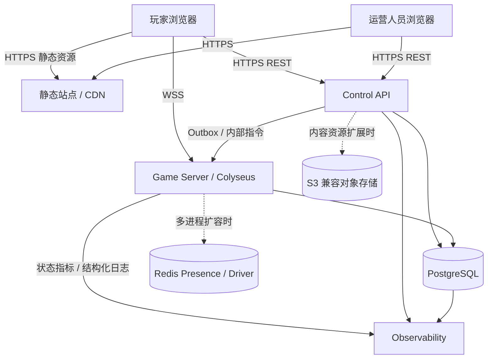
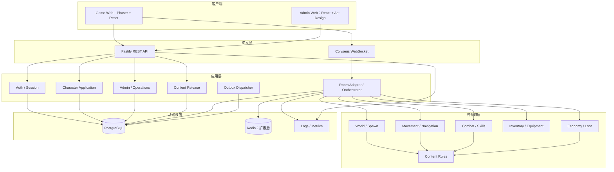
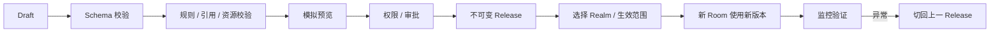

# Web Legend —— 浏览器多人传奇类 MMORPG 技术架构

> 文档类型：技术架构基线（Architecture Baseline）  
> 版本：2.0  
> 状态：供 Codex 实施使用  
> 基准日期：2026-11-24  
> 项目形态：浏览器即开即玩的 2D / 伪等距多人在线角色扮演游戏  
> 配套文档：`WEB_LEGEND_MVP_PLAN_v2.md`

---

## 0. 架构决策摘要

### 0.1 最终产品方向

Web Legend 是一款**浏览器原生、多人在线、持久化、可持续更新内容的传奇类 MMORPG**。

玩家通过 URL 进入游戏，不需要下载独立客户端。游戏采用经典 2D 斜 45° / 伪等距视觉语言，核心体验围绕：

- 角色创建、职业、等级、属性成长；
- 主城、野外地图、怪物刷新与探索；
- 点击移动、目标选择、自动攻击、技能释放；
- 怪物击杀、经验、金币、装备掉落；
- 背包、装备、角色战力成长；
- 同地图玩家、实时聊天、组队和基础 PK；
- 区服、线路、地图实例和持续版本更新。

产品目标不是复刻一款单机 HTML 演示，也不是先建一个庞大的 MMO 中台再填入游戏，而是**先做出一款小而完整、真实多人、资产可靠、可以持续加内容的在线游戏**。

### 0.2 核心技术决策

| 领域 | 最终选择 | 决策 |
|---|---|---|
| 游戏形态 | Web-first 2D / 伪等距 MMORPG | 保持浏览器即玩，优先实现经典传奇体验 |
| 游戏渲染 | Phaser 4 + TypeScript | 保留原方案；适合 2D 地图、精灵、动画、输入和摄像机 |
| 游戏 UI | React + TypeScript | React 负责 DOM/HUD/背包/弹窗；Phaser 只负责游戏世界表现 |
| 构建 | Vite | 客户端与后台分别构建，静态资源 hash 化 |
| 实时服务器 | Colyseus 0.18.x | Room 生命周期、状态同步、固定步长、重连和多进程扩展 |
| HTTP API | Fastify 5.x | 登录、角色、管理后台、内容和运营 API |
| 服务端运行时 | Node.js 26 LTS | 锁定 LTS 主版本；初始化时验证依赖兼容矩阵 |
| 数据库 | PostgreSQL 18.x | 持久资产、账号角色、货币账本、发布记录和审计的事实来源 |
| ORM | Drizzle ORM | 类型安全、SQL 可见；关键并发事务允许使用显式 SQL |
| 校验 | Zod | API、实时消息、内容配置和环境变量共享 schema 校验 |
| 缓存/协调 | Redis 8.2 Extended（扩容阶段启用） | 多 Game Server 的 Presence/Driver、短期缓存和协调；不是资产数据库 |
| 后台 UI | React + Ant Design 6 | 数据密集型工作台；必须进行自定义视觉设计 |
| 地图编辑 | Tiled | 地图、碰撞、刷怪点、NPC、传送点和对象层 |
| 测试 | Vitest + Playwright | 领域测试、集成测试、真实浏览器联机 E2E |
| 观测 | Pino + Prometheus；需要时接入 OpenTelemetry/Grafana | 先观测核心运行指标，不先搭复杂平台 |
| 本地环境 | Docker Compose | 开发环境一键启动；生产不强制 Kubernetes |

**版本纪律：** 不把 `latest` 写入生产依赖。仓库初始化时重新检查官方兼容性，锁定具体 patch 并提交 lockfile。本文中的主版本是架构决策，不是永久不变的版本承诺。

### 0.3 最重要的架构原则

1. **先模块化单体，后按真实负载拆分。** 共享一个 Monorepo 和领域模型，不先引入微服务、Kafka、Kubernetes、Service Mesh。
2. **服务端权威。** 客户端提交操作意图，服务器验证移动、战斗、掉落、交易和资产变化。
3. **Room 是地图实例运行容器，不是整个游戏世界。** 一个地图实例由一个 Colyseus Room 承载。
4. **实时模拟与持久化分离。** 20Hz 模拟不等待 SQL、HTTP、文件 IO 或外部模型调用。
5. **PostgreSQL 是唯一持久事实来源。** Redis 只负责协调、缓存和短期状态。
6. **内容数据和程序行为分离。** 数值、掉落、地图配置可版本化；新增行为需要代码发布，禁止后台执行任意脚本。
7. **版本可追踪、发布不可变、回滚切指针。** 代码、协议、数据库、内容和资源分别版本化。
8. **先做完整纵向切片，再横向扩功能。** 每个阶段都必须真实可玩、可测试、可复现。
9. **不为想象中的规模造系统。** MVP 以单地图 30 人稳定、50 人压力验证为目标，容量只以实测报告为准。

---

## 1. 对 GPT 原方案的评审与调整

原技术架构的核心方向正确，建议保留以下决策：

- Phaser + React 双层客户端；
- Colyseus 房间模型和服务端权威；
- PostgreSQL + Drizzle；
- Tiled 地图资源管线；
- 纯领域逻辑与 Room 适配器分离；
- Realm / Map Template / Map Instance / Room 的世界模型；
- 货币账本、物品唯一归属、幂等命令和数据库事务；
- 内容 Release 不可变、Room 固定内容版本；
- PostgreSQL Outbox、管理审计和版本回滚；
- 不在 MVP 引入 Kafka、Kubernetes 和微服务网格。

但原方案有四处需要实质调整：

### 1.1 缩小第一阶段基础设施范围

原方案要求阶段 0 就建立 `game-web`、`admin-web`、`control-api`、`game-server`、`worker` 五个独立应用，并在本地强制运行 PostgreSQL、Redis 和可选 MinIO。

调整为：

- 前端仍拆分 `game-web` 和 `admin-web` 两个构建应用；
- 后端保留 `control-api` 和 `game-server` 两个清楚的进程边界；
- Outbox dispatcher 在 MVP 可以作为 `control-api` 内部受控后台任务运行，不单独部署 Worker；
- 单进程 Colyseus 使用内存 Presence/Driver；Redis 在多 Game Server 扩容阶段启用；
- MVP 的静态图片、音效和地图资源先采用版本化静态资源；不强制 MinIO。

这不是放弃扩展，而是把扩展点留在正确边界上，避免在第一天就增加无收益的运维工作。

### 1.2 尽早验证真实多人联机

原方案先完成单机切片，之后才引入账号和网络。这样容易把客户端写成单机架构，再为联网重构大量状态逻辑。

调整为：第一条可玩切片就包含两个独立浏览器、一个 Colyseus Room、服务端玩家位置和实时同步。账号系统可以先用仅限开发环境的临时身份，但不允许把临时身份带入正式验收。

### 1.3 明确实时状态与持久资产的边界

原方案提到 Room 可依赖 persistence，但没有把“tick 不等待数据库”和“事务完成后才能确认资产操作”写成足够强的执行约束。

本架构将其定义为不可违反的规则：

- Room tick 只更新内存中的世界模拟状态；
- 资产命令走异步 Application Service + PostgreSQL 事务；
- 物品、金币、经验等结果只有在事务提交成功后才发给玩家确认；
- 角色位置、HP/MP 等普通快照采用节流 checkpoint；
- 游戏服崩溃时可以丢失少量未 checkpoint 的瞬时状态，但不能丢失已经提交的物品、货币和成长奖励。

### 1.4 把传奇类的游戏设计和美术管线写进架构

原方案侧重技术基础设施，但传奇类游戏的核心竞争力还包括点击移动手感、角色脚底排序、地图遮挡、攻击反馈、掉落表现、HUD 信息层级和美术一致性。

新增地图坐标规范、脚底锚点、Y-sort、动画状态、资源命名、Sprite Atlas、地图碰撞编译和风格锁定要求。视觉层不是后期装饰，而是 MVP 的核心交付。

---

## 2. AI Arcade 研究结论与对本项目的启发

### 2.1 研究对象

研究了 `https://aiarcade.games/` 首页、About、游戏详情页、源码入口，以及站内的多人作品《盐线行动 Online》。

AI Arcade 的产品特点：

- 浏览器即开即玩；
- 首页按类别、热度和新作品组织游戏；
- 游戏详情页包含操作说明、作品介绍、提示词和源码入口；
- 很多作品以单文件 HTML 交付，将渲染、逻辑、音效和程序化资源放在一起；
- 托管游戏运行在隔离 iframe sandbox 中；作者托管作品可单独打开或嵌入。

《Saltline》是一个使用 Three.js、WebGL、Web Audio API 和程序化资源的浏览器 3D 单机作品。站点展示其约 1.4MB 的单文件构建。其多人改编版《盐线行动 Online》是独立增加的多人项目，使用 Node.js、Express、WebSocket 和 Three.js；项目 README 说明没有数据库，排行榜写在本地文件中。

### 2.2 应借鉴的部分

1. **即开即玩：** URL 打开，资源加载完成即进入游戏，不要求安装。
2. **AI 原型能力：** 用 Codex/模型快速产出玩法验证、地图概念、UI 方案、动画测试和程序化特效。
3. **可检查、可迭代：** 每个玩法原型都有明确说明、输入、目标和完成标准；可将优秀原型迁入正式模块。
4. **浏览器适配：** 资源压缩、加载速度、全屏、输入捕获和设备适配都属于体验设计。

### 2.3 不应照搬的部分

单文件 HTML 适合离线小游戏、玩法原型和源码展示，不适合作为持久化 MMORPG 的生产架构。正式 Web Legend 必须有独立实时服务器、数据库、会话、内容版本和后台。

**工程约束：** AI 生成的单文件原型只允许放入 `experiments/` 或独立临时分支。通过玩法和视觉评审后，再把逻辑拆入正式模块。不得把整份 HTML 复制到生产 `game-web` 中继续堆功能。

---

## 3. 产品和玩法基线

### 3.1 视觉和操作基线

- 视觉：经典 2D 斜 45° / 伪等距地图，优先清晰、耐看、统一，不以过度炫光或复杂后处理掩盖像素质量。
- 地图：地表、低层装饰、角色/怪物、上层遮挡、前景装饰分层。
- 角色：统一脚底锚点；角色移动和攻击以脚底位置参与碰撞、排序和深度判定。
- 排序：按世界 Y / 脚底锚点排序；树冠、屋檐等遮挡物使用独立上层对象。
- 移动：鼠标点击地面寻路为主，键盘方向移动作为辅助；客户端可做路径预览，服务器重新计算并裁定合法路径。
- 战斗：点击目标、攻击距离验证、普攻、技能快捷键、冷却、受击反馈、死亡和掉落。
- 界面：角色状态、HP/MP、技能栏、背包、装备、聊天、目标信息、地图小地图和系统提示。
- 首发平台：桌面 Chrome / Edge 优先；移动端保持可加载和基本浏览，不以完整触屏战斗作为 MVP 门禁。

### 3.2 MVP 目标内容

| 项目 | MVP 基线 |
|---|---|
| 区服 | 1 个 Realm |
| 地图 | 1 张主城 + 1 张野外 |
| 职业 | 战士、法师、道士；先完成战士完整链路，再补齐其余两个基础技能 |
| 怪物 | 2 种基础怪物，支持刷新、追击、攻击、死亡和重刷 |
| 战斗 | 普攻；每职业 1 个基础主动技能 |
| 社交 | 同地图聊天、其他玩家可见、基础玩家信息 |
| 掉落 | 经验、金币、普通装备和消耗品 |
| 角色成长 | 等级、经验、HP/MP、基础属性、装备属性 |
| PvP | 最小安全区规则：主城禁 PK、野外允许基础 PK；不做红名、爆装、复杂罪恶值 |
| 后台 | 玩家查询、Room 查询、基础运营动作、内容编辑发布、审计和回滚 |

### 3.3 MVP 不做

公会、攻城战、交易行、摆摊、邮件、跨服战场、复杂副本、宠物、坐骑、翅膀、装备强化、复杂词条市场、语音、万人同屏、3D 开放世界。

这些系统必须能沿着现有领域边界扩展，但不得在第一版提前实现。

---

## 4. 总体系统架构

### 4.1 系统上下文



### 4.2 逻辑分层



### 4.3 部署单元

MVP 采用两个后端进程，不按微服务方式拆分领域：

1. `game-web`：浏览器游戏静态资源。
2. `admin-web`：运营后台静态资源。
3. `control-api`：Fastify，负责账号、角色、票据、后台、内容发布和 Outbox dispatcher。
4. `game-server`：Colyseus，负责实时连接、地图 Room 和权威模拟。
5. `postgres`：持久数据。

Redis、独立 Worker、对象存储和多 Game Server 实例属于后续扩容能力，采用明确 adapter 接入，不作为第一阶段启动条件。

---

## 5. Monorepo 和代码模块边界

### 5.1 仓库结构

使用 `pnpm workspace`。初期不强制 Turborepo；当 CI 构建时间或任务编排确实需要时再加入。

```text
web-legend/
├─ apps/
│  ├─ game-web/                   # Phaser 世界 + React HUD
│  ├─ admin-web/                  # 运营控制台
│  ├─ control-api/                # Fastify REST + Outbox dispatcher
│  └─ game-server/                # Colyseus Rooms / authoritative simulation
├─ packages/
│  ├─ contracts/                  # API DTO、消息名、协议版本、错误码
│  ├─ content-schema/             # Zod 内容 schema、effect DSL
│  ├─ game-domain/                # 纯函数：移动、战斗、掉落、物品、成长
│  ├─ game-simulation/             # 固定 tick、实体状态转移、领域事件
│  ├─ game-application/            # 用例编排、命令处理、事务边界
│  ├─ persistence/                # Drizzle schema、repository、migrations
│  ├─ auth/                       # 玩家会话、管理员身份和权限 adapter
│  ├─ map-runtime/                # Tiled 编译产物、碰撞和寻路读取
│  ├─ observability/              # Pino、metrics、trace 封装
│  ├─ config/                     # env schema、运行参数
│  └─ testkit/                    # fixtures、fake clock、RNG、测试工厂
├─ content/
│  ├─ realms/
│  ├─ classes/
│  ├─ skills/
│  ├─ items/
│  ├─ monsters/
│  ├─ drops/
│  └─ maps/
├─ assets/
│  ├─ source/                     # 原始美术资源
│  └─ generated/                 # atlas、压缩音频、manifest
├─ experiments/                  # AI 原型；禁止生产运行时直接引用
├─ infra/
│  ├─ docker/
│  ├─ deploy/
│  ├─ monitoring/
│  └─ scripts/
├─ docs/
│  ├─ WEB_LEGEND_TECHNICAL_ARCHITECTURE.md
│  ├─ WEB_LEGEND_MVP_PLAN.md
│  ├─ ADR/
│  └─ runbooks/
├─ tests/
├─ AGENTS.md
├─ pnpm-workspace.yaml
├─ package.json
└─ README.md
```

### 5.2 强制依赖方向

- `contracts`、`content-schema` 不依赖任何 app。
- `game-domain` 不依赖 Phaser、React、Colyseus、Fastify、数据库或外部 API。
- `game-simulation` 只依赖 `game-domain`、`content-schema` 和必要 contracts。
- `game-application` 负责编排用例和持久化事务，不把业务规则写入 Room。
- `game-server` 依赖 Colyseus、simulation、application、persistence。
- `control-api` 依赖 auth、application、persistence；不访问 Room 内部对象。
- `game-web` 只能导入 contracts、客户端表现模块和资源 manifest；不能导入服务端领域规则和数据库代码。
- `admin-web` 只能通过 control-api 访问数据。

使用 ESLint import-boundary 或 dependency-cruiser 在 CI 中校验。

### 5.3 Room 的职责

Room 只负责：

- 连接身份校验和玩家加入/离开；
- 加载该 Room 固定的 MapRuntimeManifest 和 Content Release；
- 接收、限频和路由客户端命令；
- 调用 Simulation / Application；
- 将公开状态同步给相关客户端；
- 处理重连、Room 生命周期和清理。

Room 不负责：战斗公式、掉落算法、背包规则、金币事务、HTTP 路由、SQL 拼接、AI 调用或美术资源加载。

---

## 6. 世界、地图与实例模型

### 6.1 世界层级

```text
Environment
  └─ Realm（逻辑区服）
      └─ Map Template（地图模板）
          └─ Map Instance（线路 / 副本实例）
              └─ Colyseus Room（单进程运行容器）
                  ├─ Players
                  ├─ Monsters / NPCs
                  ├─ Ground Drops
                  └─ Runtime Events
```

### 6.2 关键对象

- `Realm`：玩家角色所属的逻辑世界，例如 `classic-01`。
- `MapTemplate`：主城、野外等静态地图定义。
- `MapInstance`：地图模板的一次运行实例，例如野外 1 线、野外 2 线或某个副本。
- `Room`：Colyseus 的实时运行容器，一个 Room 只属于一个 Game Server 进程。
- `RoomOwner`：运行该 Room 的 Game Server 实例 ID；MVP 只有一个实例，扩容后必须记录和路由。

### 6.3 地图实例规则

- 主城 MVP 使用固定实例；野外允许固定 1 线，后续根据人数新增线路。
- 同一个地图实例只允许一个权威 Room。
- 玩家跨地图时由服务端执行 transfer：校验出口、保存必要状态、离开旧 Room、加入目标 Room；客户端不得自行改变 mapId。
- Room 启动时固定 `contentReleaseId` 和 `assetManifestVersion`。
- 地图结构发布不修改正在运行的 Room；创建新实例并 drain 旧实例。

### 6.4 Colyseus 多进程边界

Colyseus 扩容不是把一个 Room 的内存状态自动迁移到另一个进程。每个 Room 属于创建它的进程，客户端 WebSocket 也必须连接到该进程。

扩容阶段必须实现：

1. 每个 Game Server 注册 `serverInstanceId`、`publicAddress`、健康状态和容量指标。
2. 使用 Redis Presence + Driver 共享 Room 发现和 seat reservation。
3. 为每个进程提供可被客户端访问的地址，并正确配置负载均衡入口。
4. 玩家断线重连时路由到原 Room 所在进程。
5. 进程崩溃后不承诺内存 Room 无损迁移；客户端重新获取游戏票据，从 PostgreSQL 已提交档案恢复并重新入图。
6. 正常升级采用 Room drain：停止接收新玩家、通知安全下线/切换、写入 checkpoint、关闭旧 Room。

MVP 只有一个 Game Server，不提前实现复杂的跨进程迁移机制，但数据模型和运维接口必须保留进程归属字段。

---

## 7. 地图和美术资源管线

### 7.1 地图编辑

使用 Tiled 编辑器，地图源文件纳入版本控制。运行时不直接信任客户端上传的地图 JSON。

地图图层约定：

- `ground`：地面 Tile；
- `deco_low`：低层装饰；
- `collision`：阻挡格和不可通行区域；
- `navigation`：可通行格、移动代价和导航标记；
- `spawn_points`：怪物/玩家刷出点；
- `portals`：地图出口和目标坐标；
- `npc_points`：NPC 坐标和配置 ID；
- `deco_high`：需要覆盖角色的高层装饰；
- `ambient_zones`：环境音和局部效果，可后续启用。

### 7.2 地图编译

构建工具将 Tiled 源文件编译成 `MapRuntimeManifest`，至少包含：

- 地图稳定 ID、schemaVersion、宽高和坐标约定；
- tile / tileset 引用和 asset manifest；
- 碰撞网格、导航网格、地形移动代价；
- 出生点、传送点、NPC 点和怪物刷点；
- 可走区域校验结果和 checksum。

同一份编译产物供客户端加载和服务器验证使用。客户端可以显示路径预览，但服务器必须使用权威碰撞/导航数据重新计算移动结果。

### 7.3 坐标和渲染

- 逻辑坐标使用 tile 坐标或整数子格坐标，不使用屏幕像素作为游戏判定。
- 客户端通过投影函数将逻辑坐标转成斜 45° / 伪等距屏幕坐标。
- 角色、怪物、NPC 使用脚底锚点作为排序基准。
- 角色深度按脚底世界 Y 排序；需要遮挡的树冠、屋檐进入高层装饰层。
- 碰撞、寻路和攻击距离基于逻辑世界坐标，不能受浏览器缩放或摄像机影响。

### 7.4 美术资源规范

建立资源规范后再批量制作：

- 固定 Tile 尺寸、角色画布尺寸、脚底锚点和方向顺序；
- 动画命名统一：`idle`、`walk`、`attack`、`hurt`、`death`、`cast`；
- 方向命名统一：`n/ne/e/se/s/sw/w/nw`，若资源只提供四方向则由表现层映射；
- 精灵进入 Atlas 前检查透明边、pivot、帧尺寸和帧序；
- 资源 manifest 包含稳定 assetId、hash、尺寸、atlas、动画定义和版本；
- 同一地图和角色不得混用比例、描边、光照和色彩风格明显不同的素材。

**视觉门禁：** 主城、野外、战士、两种怪物、基础攻击和一组掉落物必须先形成统一风格样板，经人工确认后再扩展更多资源。不得用 Emoji、彩色方块或纯 CSS 形状冒充最终游戏美术。

---

## 8. 实时网络与权威模拟

### 8.1 网络分工

| 通道 | 协议 | 职责 |
|---|---|---|
| 静态资源 | HTTPS | JS、图集、地图、音频、manifest |
| 玩家/后台 API | HTTPS REST | 登录、角色、内容、运营、发布 |
| 实时游戏 | WSS / Colyseus | 移动输入、战斗指令、状态同步、聊天 |
| 服务端管理命令 | 内部 HTTP + PostgreSQL Outbox | Kick、公告、维护、Room 控制；扩容后可配合 Redis |

不使用 WebRTC P2P 作为权威战斗通道。

### 8.2 模拟和同步频率

初始参数：

- 服务端固定模拟：20Hz，tick = 50ms；
- Room 状态同步：10Hz，patch 间隔约 100ms；
- 客户端渲染：requestAnimationFrame，目标 60 FPS；
- 客户端移动输入：事件驱动，建议 10–20 次/秒上限；
- 远端实体：使用插值缓冲，避免直接跳变；
- 本地角色：允许短期预测和服务端 reconciliation。

这些是可测的初始参数，不是永久常量。Room 记录 tick duration、tick drift、patch bytes、玩家数和连接状态。

### 8.3 客户端只能提交意图

```ts
// Client -> Server examples
{
  protocolVersion: 1,
  commandId: "uuid",
  clientSequence: 108,
  type: "move.to",
  payload: { targetTileX: 31, targetTileY: 18 }
}

{
  protocolVersion: 1,
  commandId: "uuid",
  clientSequence: 109,
  type: "combat.basicAttack",
  payload: { targetId: "monster-123" }
}
```

客户端不得提交最终坐标、伤害、暴击、怪物死亡、掉落清单、经验或货币结果。

### 8.4 服务端移动

1. 客户端提交目标 tile 和递增序号。
2. 服务器校验角色会话、地图、速度和目标是否合法。
3. 服务器使用权威导航网格计算路径。
4. Simulation 按固定 tick 推进角色位置并执行碰撞约束。
5. 本地客户端根据输入短期预测，收到服务端状态后校正。
6. 远端客户端对服务器位置做插值。

客户端不提交任意路径并要求服务器照单全收。

### 8.5 服务端战斗

```text
收到战斗意图
  -> 校验会话、角色状态和目标
  -> 校验同地图、可见性、距离和攻击间隔
  -> 校验技能等级、冷却、资源消耗
  -> 读取 Room 固定的 Content Release
  -> 使用服务端 RNG 计算命中、伤害、暴击和效果
  -> 更新 Simulation 内存状态
  -> 产生领域事件
  -> 若触发经验/掉落/货币等持久奖励，交给 Asset Application Service
  -> 事务提交成功后通知玩家获得正式奖励
  -> 广播战斗表现事件
```

动画、伤害数字、音效和特效由客户端播放；这些表现可以预测，但不能提前增加正式资产。

### 8.6 AOI（兴趣区域）

MVP 先按地图实例隔离，单地图玩家数不超过目标容量。仍需把 `InterestManager` 设计成独立模块：

- 地图按固定逻辑 cell 分区；
- 玩家只接收自身 cell 和相邻 cell 的公开实体；
- 离开 AOI 后停止同步；销毁实体时清理引用；
- 私有背包、账号信息、GM 标记不得进入公开 Room State。

不要用每 tick 的全量 O(N²) 距离扫描作为长期方案。

### 8.7 重连和崩溃恢复

- 正常短断线：Room 仍然存在时使用 Colyseus reconnection flow，设置 grace period。
- 页面刷新：使用短期 reconnect token；token 只保存在 sessionStorage，不长期保存在 localStorage。
- Room 所属进程崩溃：旧 Room 不再存在，重连 token 不能保证恢复；客户端重新获取游戏 ticket，服务器从持久档案恢复角色，再分配到可用 Room。
- 已提交的物品、金币和成长奖励必须安全；未 checkpoint 的临时位置、怪物 AI 位置和短期战斗状态允许按规则重建。
- 玩家角色设置单活跃会话 lease，避免两个浏览器同时控制同一角色。

---

## 9. 领域模块

| 模块 | 核心职责 | 不应该承担 |
|---|---|---|
| Account | 账号、密码、会话和封禁状态 | 战斗状态 |
| Character | 角色、职业、等级、属性、出生位置 | 网络连接和场景渲染 |
| Movement | 寻路、速度、碰撞、传送 | 屏幕像素和 Phaser Scene |
| Combat | 普攻、技能、命中、伤害、冷却、仇恨 | 动画播放、网络包拼装 |
| World | 地图实例、NPC、刷怪、怪物状态机 | 账号认证 |
| Loot | 掉落表、随机数、归属和过期 | 客户端生成掉落 |
| Inventory | 背包格子、物品实例、装备、堆叠 | 直接拼 SQL |
| Economy | 钱包、金币账本、产出与消耗 | 绕过 ledger 直接改余额 |
| Social | 同图聊天、组队、好友、公会扩展点 | 客户端自判权限 |
| Content | 职业、技能、物品、怪物、地图规则 | 执行任意脚本 |
| Moderation | 踢下线、禁言、封禁和 GM 命令 | 无审计后台写入 |

### 9.1 领域函数

```ts
resolveMovement(input): MovementResult
resolveBasicAttack(input): CombatResult
resolveSkillCast(input): SkillResult
resolveMonsterDecision(input): MonsterAction
rollLoot(input, rng): LootResult
applyInventoryCommand(input): InventoryResult
calculateCharacterStats(input): CharacterStats
```

函数应有明确输入输出；随机数、时钟和外部副作用通过参数或 adapter 注入。禁止业务规则散落在 Room、REST route 和 React 回调中。

### 9.2 内容定义与技能效果 DSL

职业、技能、怪物、物品、掉落和地图属性全部采用稳定 ID + schemaVersion 的数据定义。

技能效果使用受控的 Effect DSL，例如：

- `directDamage`
- `projectile`
- `areaDamage`
- `heal`
- `applyStatus`
- `temporaryBuff`

每种 Effect 都由代码中已实现的 handler 执行。内容编辑器只配置参数，不允许输入 JavaScript、eval、动态 import 或任意脚本。

新增一种效果行为需要代码变更、测试和服务端发布；只调伤害、范围、冷却、掉落概率等现有字段可以通过内容发布更新。

---

## 10. 数据库、资产一致性和持久化

### 10.1 数据归属

| 数据 | 事实来源 | 说明 |
|---|---|---|
| 账号、会话、角色 | PostgreSQL | 永久持久化 |
| 经验、等级、基础属性 | PostgreSQL | 通过事务或 checkpoint 持久化 |
| 装备、背包、物品实例 | PostgreSQL | 唯一归属和事务保护 |
| 金币 | PostgreSQL wallet + ledger | 余额和流水必须同事务更新 |
| 地面掉落 | Room 内存 + PostgreSQL 资产记录 | 物品已生成后需有唯一归属和领取状态 |
| 当前 Room 状态 | Game Server 内存 | 瞬时状态，进程崩溃可重建 |
| Room/服务器发现 | 单进程内存；扩容后 Redis | 不作为资产事实来源 |
| 内容 Release | PostgreSQL 不可变记录 | Room 创建时固定版本 |
| 图片/音频/地图资源 | 版本化静态资源；后续 CDN / S3 | 以 hash/manifest 标识 |
| 审计、Outbox | PostgreSQL | 追加记录、可靠重试 |

### 10.2 MVP 核心表

建议至少建立以下表，字段可在 ADR 和 schema 评审中细化：

| 表 | 关键字段和约束 |
|---|---|
| `accounts` | id、username、password_hash、status、created_at |
| `account_sessions` | id、account_id、refresh_token_hash、expires_at、revoked_at |
| `realms` | id、code、status、active_content_release_id |
| `characters` | id、account_id、realm_id、name_normalized、class_id、level、exp、hp、mp、map_id、position、version |
| `character_sessions` | character_id、session_id、game_server_id、lease_expires_at，防止多端同时控制 |
| `item_instances` | id、template_id、owner_character_id、container、slot、quantity、affixes、version |
| `wallets` | character_id、currency_type、balance、version |
| `currency_ledger` | id、character_id、delta、balance_after、reason、reference_id、idempotency_key |
| `world_drops` | id、map_instance_id、item_instance_id、position、owner_rule、expires_at、claimed_at |
| `content_drafts` | id、content_type、payload JSONB、updated_by、updated_at |
| `content_releases` | id、version、checksum、schema_version、manifest、created_by、status |
| `realm_active_content` | realm_id、content_release_id、updated_at |
| `admin_users` / `admin_roles` | 管理员身份和 RBAC |
| `admin_audit_logs` | actor、action、target、reason、before、after、request_id、result、created_at |
| `outbox_events` | id、type、payload、created_at、published_at、attempts、idempotency_key |

ID 使用 UUIDv7 或统一有序 ID 策略。并发写入实体使用行锁或乐观锁，不能依赖前端按钮禁用防止竞争。

### 10.3 事务边界

下列操作必须在同一 PostgreSQL 事务中提交：

**拾取物品**

1. 锁定 `world_drops` 记录；
2. 校验未领取、拾取范围、归属规则和背包容量；
3. 更新 `item_instances` 容器和 owner；
4. 标记 `world_drops.claimed_at`；
5. 写入领域审计/Outbox（需要跨进程通知时）。

**获得金币**

1. 检查 idempotency key；
2. 更新 wallet；
3. 插入 currency ledger；
4. 写入 Outbox（如需广播或统计）。

**获得经验/击杀奖励**

1. 记录唯一 kill/reward reference；
2. 更新角色经验和等级；
3. 创建物品实例/地面掉落；
4. 更新相关货币；
5. 写入 Outbox；
6. 提交后才返回正式奖励确认。

**装备/卸下**

1. 锁定角色和物品记录；
2. 校验 owner、容器、装备槽和职业要求；
3. 更新物品位置；
4. 更新角色版本或派生属性缓存；
5. 提交后返回新属性。

### 10.4 实时 tick 和数据库的隔离规则

- `GameSimulation.step()` 不允许 `await` 数据库、HTTP、文件系统、模型 API 或 Redis 网络请求。
- 角色移动、怪物追击、寻路推进、攻击动画状态等短期模拟在内存中更新。
- 持久资产动作通过异步 Application Service 执行，并使用命令 ID 幂等。
- 关键资产操作未提交前，不给客户端正式成功 ACK；失败时恢复内存中的待提交状态或执行补偿。
- 位置、HP/MP、短时状态采用合并 checkpoint，例如 15–30 秒或地图切换/正常离开时保存；具体间隔根据压测和体验确定。
- 玩家异常断线不能直接删除角色资产；由 lease 过期和恢复流程处理。

### 10.5 不采用完整 Event Sourcing

不对每个位置、每个怪物 tick 和每个动画帧记录永久事件。只对有资产价值或管理价值的事件保存追加记录：货币流水、物品流转、奖励结算、管理员写操作和 Outbox。

---

## 11. API、实时协议和会话

### 11.1 REST API

统一前缀 `/api/v1`，自动生成 OpenAPI，统一错误结构、requestId、分页和幂等要求。

玩家接口：

```text
POST   /api/v1/auth/register
POST   /api/v1/auth/login
POST   /api/v1/auth/refresh
POST   /api/v1/auth/logout
GET    /api/v1/me
GET    /api/v1/realms
GET    /api/v1/characters
POST   /api/v1/characters
POST   /api/v1/game/ticket
GET    /api/v1/characters/:id
```

管理员接口：

```text
GET    /api/v1/admin/dashboard
GET    /api/v1/admin/players
GET    /api/v1/admin/players/:id
GET    /api/v1/admin/rooms
GET    /api/v1/admin/rooms/:id
POST   /api/v1/admin/players/:id/actions/kick
POST   /api/v1/admin/players/:id/actions/ban
POST   /api/v1/admin/players/:id/actions/mute
GET    /api/v1/admin/content/drafts
PUT    /api/v1/admin/content/drafts/:id
POST   /api/v1/admin/content/validate
POST   /api/v1/admin/content/releases
POST   /api/v1/admin/content/activate
GET    /api/v1/admin/audit-logs
```

### 11.2 游戏连接票据

- 玩家登录后由 Control API 签发短时 game ticket；
- ticket 绑定 accountId、characterId、realmId、issuedAt、expiresAt、nonce；
- WebSocket 握手时校验并消费 ticket；
- 不允许客户端通过 join options 自报 accountId/characterId；
- 一个角色同一时刻只允许一个 active session，重复登录需定义替换或拒绝策略。

### 11.3 实时命令

Client → Server：

- `move.to`
- `combat.basicAttack`
- `skill.cast`
- `loot.pickup`
- `inventory.use`
- `inventory.equip`
- `inventory.unequip`
- `chat.send`
- `player.ping`

Server → Client：

- Colyseus Schema state patches；
- `command.ack` / `command.rejected`；
- `combat.hit` / `combat.miss` / `combat.death`；
- `loot.spawned` / `loot.claimed`；
- `inventory.updated`；
- `character.stats.updated`；
- `chat.message`；
- `system.notice`；
- `session.kicked` / `session.expiring`。

每条命令定义 Zod schema、字段上下限、频率限制、身份权限、幂等策略和错误码。

### 11.4 版本兼容

- `protocolVersion` 独立于前端版本、服务端版本和内容版本；
- 服务端定义 `minSupportedProtocol` 和 `currentProtocol`；
- 新增字段优先可选；删除或改变语义需要版本升级；
- 部署采用先兼容、再切换、最后清理旧协议；
- 不兼容连接返回明确错误，提示刷新或更新客户端。

---

## 12. 内容管理和版本发布

### 12.1 内容原则

内容配置包含稳定 ID、schemaVersion 和结构化参数；服务端只加载已校验、已发布的不可变 Release。

内容类型：

- Realm / Map / Spawn；
- Class / Attribute / Growth；
- Skill / Effect；
- Monster / AI Parameters；
- Item / Equipment / Consumable；
- Drop Table；
- NPC / Portal / Basic Shop。

### 12.2 编辑和发布流



发布校验至少包括：

- 所有引用 ID 存在；
- 数值、冷却、资源消耗范围合法；
- 掉落权重合法且非负；
- 刷怪点在可走区域；
- 传送目标和 NPC 配置存在；
- Effect DSL handler 已实现；
- 资源 manifest 引用存在；
- schemaVersion 与当前服务端兼容；
- map checksum 和 asset manifest checksum 匹配。

### 12.3 热更新分级

| 内容类别 | 生效策略 |
|---|---|
| 公告、文本、可安全切换的数值参数 | 可按规则热更新或在下一个安全操作点生效 |
| 技能数值、掉落权重、怪物基础数值 | 新 Room 生效；正在战斗的 Room 依赖固定快照 |
| 地图碰撞、导航网格、传送点、刷怪点 | 新建 Map Instance，排空旧实例 |
| 新增技能效果行为、领域规则、协议变化 | 代码发布，不能靠后台 JSON 热更新 |
| 数据库结构变化 | 版本化 migration，采用 Expand → Migrate → Contract |

### 12.4 五种版本

| 版本 | 示例 | 管理对象 |
|---|---|---|
| Application | `game-server 0.3.0` | 代码和容器镜像 |
| Protocol | `protocol 1` | 客户端/服务端消息契约 |
| Database | `migration 0042` | PostgreSQL schema |
| Content | `content 2026.11.24.1` | 职业、技能、怪物、物品、掉落和地图定义 |
| Assets | `manifest sha256:...` | 图集、地图、音效和动画资源 |

---

## 13. 智能运营后台

### 13.1 后台信息架构

```text
Admin Console
├─ Overview
│  ├─ 在线人数 / 峰值 / 新增角色
│  ├─ Realm / Map / Room 分布
│  ├─ Game Server 健康 / tick p95
│  └─ 最近错误 / 告警 / 发布事件
├─ Players
│  ├─ 账号和角色查询
│  ├─ 等级 / 装备 / 背包 / 货币只读信息
│  ├─ 在线状态 / 所在地图 / session
│  └─ Kick / Ban / Mute
├─ World
│  ├─ Realm / 地图模板 / 地图实例
│  ├─ Room / 服务器归属 / 在线人数
│  ├─ 地图维护 / 实例排空
│  └─ 怪物刷点和运行状态摘要
├─ Game Content
│  ├─ 职业 / 属性 / 技能
│  ├─ 怪物 / AI 参数 / 掉落表
│  ├─ 物品 / 装备 / 消耗品
│  └─ 地图配置 / NPC / 传送点
├─ Release Center
│  ├─ Draft / 校验 / 差异预览
│  ├─ 发布审批 / 激活 / 回滚
│  └─ Release 历史和兼容性
├─ Operations
│  ├─ 公告 / 维护模式
│  ├─ Kick / Ban / Mute
│  └─ GM 命令（权限受控、全部审计）
├─ Audit
│  ├─ 操作者 / 动作 / 对象 / 原因 / 时间
│  └─ 请求 ID / 执行结果 / 变更前后摘要
└─ AI Assistant（后续阶段）
   ├─ 运行异常摘要
   ├─ 经济和掉落分析
   └─ 操作建议草案
```

### 13.2 后台交互要求

- 不直接套用默认后台模板；信息密度适中、主次明确、颜色克制。
- Overview 先展示异常和关键指标，不使用大量装饰卡片。
- 表格支持服务端分页、搜索、筛选、排序和 ID 复制。
- 内容状态清楚区分 Draft / Validated / Pending / Published / Active / Rolled Back。
- 高风险写操作显示对象、影响范围、原因输入和二次确认。
- 玩家资产默认只读；需要资产修复时走独立、可审批、可审计的 GM 操作。

### 13.3 权限和审计

MVP 采用本地管理员身份 + 服务端 RBAC，管理员身份与玩家身份逻辑隔离；生产环境可接 OIDC/MFA。权限角色建议：

- `super_admin`
- `ops_admin`
- `game_master`
- `content_designer`
- `release_approver`
- `analyst`
- `readonly_auditor`

所有写操作必须经过 API 权限校验。审计记录追加写入，不允许通过 UI 编辑或删除。至少记录 actor、role、action、target、reason、before/after、requestId、timestamp、result。

### 13.4 后台命令可靠投递

1. Admin API 鉴权并校验操作原因。
2. PostgreSQL 事务写入操作记录和 Outbox。
3. Outbox dispatcher 读取待处理命令。
4. 向目标 Game Server 的受信任内部端点投递 commandId 和 payload。
5. Game Server 校验目标和 commandId 后执行。
6. 回写执行回执，后台显示 `pending / dispatched / applied / failed`。

Outbox 是可靠记录，HTTP 或 Redis 只是传输通道。重复投递必须由 commandId 幂等处理。

### 13.5 AI 助手策略

AI Ops 不属于 MVP 核心门禁，放到后续版本。初始只读：调用 allowlist 查询指标、错误摘要、Room 状态和经济聚合，不开放任意 SQL。

后续要执行操作时，AI 只能生成变更草案；必须由有权限的人确认，再由确定性 API 执行。AI 不得自行发放货币、修改装备、封禁账号、发布内容或更改生产配置。

---

## 14. 身份、安全和反作弊

### 14.1 玩家身份

- 账号密码使用 Argon2id；
- Access token 短时有效；
- Refresh token 轮换，数据库只存 hash；
- 使用 HttpOnly、Secure、SameSite Cookie 时配套 CSRF / Origin 校验；
- Game ticket 短时、一次性、绑定角色和 Realm；
- WebSocket 握手只接受服务器签发的身份，不信任客户端 accountId；
- 游戏账号和后台管理员身份分离。

### 14.2 最低安全要求

- HTTPS/WSS；
- CORS/Origin allowlist；
- REST / WebSocket 限频和 payload size limit；
- DB 最小权限；
- secrets 不进入 Git 和前端 bundle；
- 管理动作服务端 RBAC；
- 外部错误不暴露 SQL 和堆栈；
- 日志敏感字段脱敏；
- 依赖和 secret scanning 纳入 CI。

### 14.3 反作弊基本策略

先保证服务器权威，再监测异常：非法坐标、超速、穿墙、攻击频率、冷却绕过、无效目标、重复命令、异常物品数量、金币账本不平。

处理顺序：记录 → 拒绝或限速 → 标记待复核 → 人工处理。禁止只凭一次异常自动永久处罚。

---

## 15. 可观测性、性能和容量

### 15.1 必须观测的指标

| 类别 | 指标 |
|---|---|
| World | 在线玩家数、Room 数、每 Room 玩家数、地图实例数 |
| Simulation | tick p50/p95/p99、tick drift、超时 tick 数 |
| Network | WS 活跃连接、断线率、重连率、每玩家上下行 bytes、patch bytes |
| Movement | 输入到确认延迟、预测修正次数、修正距离 |
| Combat | 命令量、拒绝率、技能失败原因、死亡/复活数 |
| Persistence | DB transaction p95、失败率、连接池等待、锁等待 |
| Operations | Outbox 最老消息年龄、管理命令成功率 |
| Runtime | CPU、RSS、事件循环延迟、GC pause |

### 15.2 MVP 验收目标

| 指标 | 初始目标 |
|---|---|
| 单地图稳定在线 | 30 人 |
| 单地图压力测试 | 50 人，持续至少 10 分钟 |
| Server simulation | 20Hz |
| Room tick p95 | < 25ms |
| Room tick p99 | < 40ms |
| 状态可见延迟 | 正常网络下 250ms 内 |
| 桌面渲染 | 目标 60 FPS，常规场景不低于 45 FPS |
| 资产事务 | 提交后确认，重试不重复发放 |
| 重连 | Room 存活时可续接；进程崩溃后从持久档案重新入图 |
| 运营审计 | 后台写操作 100% 有记录 |

这些数据是固定测试机器和网络条件下的验收目标，不是未经压测的产品容量承诺。

### 15.3 扩容顺序

1. 单 Game Server + 单 PostgreSQL，先完成 MVP。
2. Game Server 和 Control API 独立部署；数据库托管化；静态资源接 CDN。
3. 若单进程 Room 数或 tick/CPU 指标达到瓶颈，再增加 Game Server。
4. 多 Game Server 时启用 Redis Presence/Driver、进程注册和连接路由。
5. 根据真实瓶颈再扩容 Outbox worker、数据库读副本或分区策略。
6. 只有在明确的部署、故障隔离和规模要求出现后才评估 Kubernetes、消息队列或领域服务拆分。

---

## 16. 发布、恢复和环境

### 16.1 环境

- `local`：Docker Compose，允许重置；
- `dev`：共享开发环境，验证多人联机和内容发布；
- `staging`：接近生产拓扑，运行回归和压测；
- `production`：严格权限、备份、监控和发布审批。

### 16.2 代码发布

- 使用不可变镜像 tag，不使用 `latest`；
- CI 完成类型检查、测试、migration 检查、协议兼容和浏览器 E2E；
- Game Server 滚动更新执行 Room drain；
- 保留上一稳定镜像；
- 数据库迁移使用 Expand → Migrate → Contract；
- 代码回滚与数据迁移回滚分开设计，禁止假设所有 migration 都可逆。

### 16.3 故障恢复

必须覆盖：

- 浏览器断网和刷新；
- Game Server 正常重启；
- Game Server 非正常退出；
- PostgreSQL 暂时不可用；
- Outbox dispatcher 中断和重复投递；
- Redis（扩容阶段）暂时不可用；
- 内容发布错误和回滚。

恢复优先级：账号和核心资产正确 > 角色重新进入地图 > 瞬时怪物状态和战斗表现恢复。

---

## 17. 测试和工程质量

### 17.1 测试金字塔

- Unit：移动、碰撞、命中、伤害、冷却、掉落、背包、装备、账本和权限。
- Integration：数据库事务、并发拾取、会话票据、Room 加入/离开、Outbox、内容发布。
- Contract：REST OpenAPI、WebSocket message schema、内容 schema 和协议兼容。
- E2E：两个独立浏览器用户同图移动、战斗、拾取、聊天、重登；后台编辑和发布内容。
- Load：30 人稳定、50 人压力；改变实体数、消息频率和技能施放量。
- Recovery：杀掉 Game Server、断网、DB 恢复、Outbox 重试和内容回滚。

### 17.2 代码品味约束

- 禁止超大 `GameScene.ts` / `MapRoom.ts` / 万能 Service；
- 禁止全局可变状态；
- 禁止使用 `any` 或大量 `as unknown as` 绕过类型；
- 禁止在 tick 中执行慢 IO；
- 禁止客户端决定伤害、掉落、余额和装备属性；
- 禁止后台直接写 Room 内存或直连 DB；
- 禁止把发布中的内容原地修改；
- 所有关键命令有幂等 ID；
- 领域逻辑使用纯函数或显式副作用接口；
- 抽象稳定边界，不为想象中的未来堆抽象。

---

## 18. 架构决策记录（ADR）

| ADR | 决策 | 状态 |
|---|---|---|
| ADR-001 | Web-first 2D / 伪等距，Phaser 4 | Accepted |
| ADR-002 | React DOM UI + Phaser Canvas | Accepted |
| ADR-003 | Colyseus Room per Map Instance | Accepted |
| ADR-004 | Server-authoritative simulation | Accepted |
| ADR-005 | PostgreSQL 为持久事实来源 | Accepted |
| ADR-006 | Redis 仅在多进程协调阶段启用 | Accepted |
| ADR-007 | 模块化单体，不先做微服务 | Accepted |
| ADR-008 | 固定 Room 内容版本，不原地热改地图 | Accepted |
| ADR-009 | 关键资产事务化，tick 与 IO 分离 | Accepted |
| ADR-010 | 不做完整 Event Sourcing | Accepted |
| ADR-011 | 后台 Effect DSL 白名单，不执行任意脚本 | Accepted |
| ADR-012 | AI Ops 后置，先只读 | Accepted |
| ADR-013 | 按真实消费者创建包，不预建空壳 | Accepted |
| ADR-014 | Node 26 / TypeScript 5.9.3 / 精确依赖 | Accepted |
| ADR-015 | 阶段 1 临时开发身份与重连凭据 | Superseded by ADR-017 |
| ADR-016 | 阶段 1 权威移动模型与技术测试地图 | Accepted |
| ADR-017 | 账号会话、一次性游戏票据与角色租约 | Accepted |

---

## 19. Codex 实施约束

Codex 必须：

1. 先完整阅读本文件和 `WEB_LEGEND_MVP_PLAN_v2.md`。
2. 阅读后先审查仓库现状和环境，不直接一次性生成所有功能。
3. 按阶段门禁开发，当前阶段没有通过验收不得跳阶段。
4. 每项新功能先定义 contracts、schema 和验收测试，再实现 UI 与基础设施。
5. 优先使用 Colyseus 0.18 当前 API；初始化时阅读官方文档并以 lockfile、类型检查和集成测试验证实际兼容性。
6. Room 只做连接和同步适配；所有游戏规则在 game-domain / game-simulation。
7. 任何资产操作必须经过事务、幂等和并发保护。
8. 不得在 GameSimulation tick 中 await 数据库、HTTP、文件 IO 或 AI 模型。
9. 不得把 Redis 当成角色、金币或物品的唯一数据源。
10. 不得通过伪造假数据、空壳页面、固定返回值或 TODO 声称验收通过。
11. 如需变更架构决策，先提交 ADR，说明动机、替代方案、影响，再更新文档。
12. 每个阶段输出变更文件、运行命令、真实测试结果、截图/日志、未完成项和风险。

---

## 20. 官方技术和研究参考

以下参考用于 Codex 初始化时再次核实依赖兼容性和当前 API。版本选择以仓库 lockfile 和 CI 实测为准。

- AI Arcade 首页与作品目录：<https://aiarcade.games/>
- AI Arcade About：<https://aiarcade.games/about>
- AI Arcade《Saltline》详情：<https://aiarcade.games/play/saltline-fable-5-2-fps>
- AI Arcade《盐线行动 Online》详情：<https://aiarcade.games/play/saltline-online>
- Saltline Online 项目 README：<https://github.com/wenzhengshi/fable5-2-salt-online>
- Phaser 官方版本归档：<https://phaser.io/download/archive>
- Colyseus 0.18 官方文档：<https://docs.colyseus.io/>
- Colyseus 0.18 迁移说明：<https://docs.colyseus.io/migrating/0.18>
- Colyseus 多进程扩展：<https://docs.colyseus.io/scalability>
- Colyseus 重连说明：<https://docs.colyseus.io/room/reconnection>
- Node.js 发布状态：<https://nodejs.org/en/about/previous-releases>
- PostgreSQL 版本策略：<https://www.postgresql.org/support/versioning/>
- PostgreSQL 19 发布公告（2026-11-19）：<https://www.postgresql.org/about/news/postgresql-19-released-3449/>
- Redis OSS 版本管理：<https://redis.io/docs/latest/operate/oss_and_stack/install/version-mgmt/>
- Tiled JSON Map Format：<https://doc.mapeditor.org/en/latest/reference/json-map-format/>
- Playwright Network / WebSocket：<https://playwright.dev/docs/network>
- OpenTelemetry JavaScript：<https://opentelemetry.io/docs/languages/js/>

