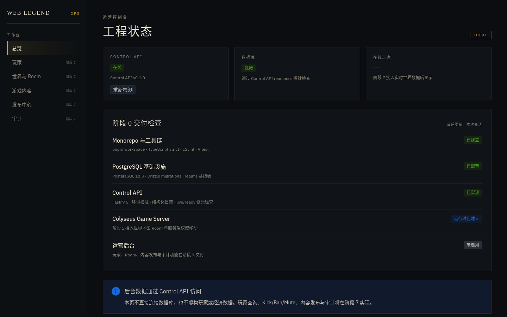

# 阶段 0 报告：工程底座与规则冻结

> 日期：2026-11-24
> 状态：已完成，等待 Tech Lead 审阅
> 基线文档：`docs/WEB_LEGEND_TECHNICAL_ARCHITECTURE_v2.md`、
> `docs/WEB_LEGEND_MVP_PLAN_v2.md`

## 1. 阶段目标与范围

建立可复现、可测试、边界清晰的工程底座；锁定运行时和依赖；建立数据库、健康检查、
日志、质量门禁和项目治理文档。

本阶段**没有**实现账号、地图、移动、战斗、掉落、背包、金币、聊天、PK 或运营后台
业务。也没有创建只有目录和接口的空壳模块。

## 2. 实际交付目录树

```text
web-mir/
├─ .editorconfig
├─ .env.example
├─ .github/workflows/ci.yml
├─ .gitignore
├─ .nvmrc
├─ .prettierignore
├─ .prettierrc.json
├─ AGENTS.md
├─ README.md
├─ apps/
│  ├─ admin-web/
│  │  ├─ index.html
│  │  ├─ package.json
│  │  ├─ src/App.tsx
│  │  ├─ src/lib/health.ts
│  │  ├─ src/main.tsx
│  │  ├─ src/styles.css
│  │  ├─ tsconfig.json
│  │  └─ vite.config.ts
│  ├─ control-api/
│  │  ├─ package.json
│  │  ├─ src/env.ts
│  │  ├─ src/index.ts
│  │  ├─ src/readiness.ts
│  │  ├─ src/server.ts
│  │  ├─ src/version.ts
│  │  ├─ test/env.test.ts
│  │  ├─ test/health.integration.test.ts
│  │  ├─ test/health.test.ts
│  │  ├─ tsconfig.json
│  │  └─ tsup.config.ts
│  ├─ game-server/
│  │  ├─ package.json
│  │  ├─ src/env.ts
│  │  ├─ src/index.ts
│  │  ├─ src/rooms/diagnosticsRoom.ts
│  │  ├─ src/server.ts
│  │  ├─ src/version.ts
│  │  ├─ test/server.integration.test.ts
│  │  ├─ tsconfig.json
│  │  └─ tsup.config.ts
│  └─ game-web/
│     ├─ index.html
│     ├─ package.json
│     ├─ src/App.tsx
│     ├─ src/game/BootScene.ts
│     ├─ src/game/createBootGame.ts
│     ├─ src/lib/health.ts
│     ├─ src/main.tsx
│     ├─ src/styles.css
│     ├─ tsconfig.json
│     └─ vite.config.ts
├─ docs/
│  ├─ ADR/（ADR-000 模板 + ADR-001…014 + README）
│  ├─ WEB_LEGEND_MVP_PLAN_v2.md
│  ├─ WEB_LEGEND_TECHNICAL_ARCHITECTURE_v2.md
│  ├─ PROJECT_STATUS.md
│  ├─ WORKLOG.md
│  └─ phase-reports/
│     ├─ PHASE_00_REPORT.md
│     └─ phase-00/{game-web.png,admin-web.png}
├─ eslint.config.js
├─ infra/docker/compose.yml
├─ package.json
├─ packages/
│  ├─ config/
│  │  ├─ package.json
│  │  ├─ src/{env.ts,env.test.ts,index.ts}
│  │  └─ tsconfig.json
│  ├─ contracts/
│  │  ├─ package.json
│  │  ├─ src/{errors.ts,health.ts,health.test.ts,index.ts,protocol.ts}
│  │  └─ tsconfig.json
│  ├─ observability/
│  │  ├─ package.json
│  │  ├─ src/{index.ts,logger.ts,logger.test.ts}
│  │  └─ tsconfig.json
│  ├─ persistence/
│  │  ├─ drizzle.config.ts
│  │  ├─ migrations/0000_public_queen_noir.sql
│  │  ├─ migrations/meta/{0000_snapshot.json,_journal.json}
│  │  ├─ package.json
│  │  ├─ src/{client.ts,index.ts,migrate.ts,migrator.ts}
│  │  ├─ src/schema/{index.ts,realms.ts}
│  │  ├─ test/migrations.integration.test.ts
│  │  └─ tsconfig.json
│  └─ testkit/
│     ├─ package.json
│     ├─ src/{clock.ts,clock.test.ts,index.ts,random.ts,random.test.ts}
│     └─ tsconfig.json
├─ playwright.config.ts
├─ pnpm-lock.yaml
├─ pnpm-workspace.yaml
├─ tests/e2e/foundation.spec.ts
├─ tsconfig.base.json
├─ tsconfig.json
└─ vitest.config.ts
```

## 3. 依赖版本与引擎兼容性

所有依赖在 `package.json` 中写精确版本，`pnpm-lock.yaml` 已提交。

| 包                         | 版本             | 引擎 / 兼容性结论                                     |
| -------------------------- | ---------------- | ----------------------------------------------------- |
| Node.js                    | 26.13.1          | 当前 LTS；通过 nvm 安装，不替换系统 Node 24           |
| pnpm                       | 11.7.0           | `packageManager` 锁定                                 |
| TypeScript                 | 5.9.3            | 最新为 7.0.2，但 typescript-eslint 8.74 仅支持 <6.1.0 |
| Phaser                     | 4.2.1            | 浏览器端，无 Node 引擎要求                            |
| @colyseus/core             | 0.18.28          | Node >=22                                             |
| @colyseus/schema           | 5.0.50           | TypeScript >=5.0                                      |
| @colyseus/ws-transport     | 0.18.5           | Node >=22                                             |
| @colyseus/sdk              | 0.18.10          | 仅测试客户端                                          |
| Fastify                    | 5.12.8           | Node >=20                                             |
| @fastify/cors              | 11.4.3           | 与 Fastify 5 兼容                                     |
| React / React DOM          | 19.3.1           | —                                                     |
| Ant Design                 | 6.7.2            | React 19 兼容                                         |
| Vite                       | 8.3.8            | Node ^20.19 / >=22.12                                 |
| @vitejs/plugin-react       | 6.3.0            | Vite 8 兼容                                           |
| Zod                        | 4.6.7            | —                                                     |
| Drizzle ORM / Kit          | 0.45.4 / 0.31.11 | PostgreSQL 方言                                       |
| postgres                   | 4.1.1            | Node >=18                                             |
| Pino / pino-pretty         | 10.4.0 / 13.2.0  | —                                                     |
| Vitest / coverage          | 5.1.1            | Node ^22.12 / ^24 / >=26                              |
| Playwright                 | 1.65.1           | Node >=20                                             |
| ESLint / typescript-eslint | 10.15.0 / 8.74.0 | ESLint 10 受支持                                      |
| Prettier                   | 3.10.1           | —                                                     |
| tsup / tsx                 | 9.0.0 / 4.23.15  | Node 26 兼容                                          |

详细决策见 [ADR-014](../ADR/ADR-014-toolchain-pinning.md)。

## 4. 运行时与基础设施

- **Node**：26.13.1（`.nvmrc`）。
- **pnpm**：11.7.0；CI 使用 `--frozen-lockfile`。
- **PostgreSQL**：本地 18.3，镜像摘要
  `docker.m.daocloud.io/postgres@sha256:a9abf4275f9e99bff8e6aed712b3b7dfec9cac1341bba01c1ffdfce9ff9fc34a`；
  生产/CI 目标为 `postgres:18.7-alpine`。
- **Redis**：位于 compose `scale` profile，阶段 0 不启动。
- **端口**：容器内 84/85/86/87（宿主机 8584/8585/8586/8587）。容器内 80 被环境
  nginx 占用。
- **数据库访问**：SSH 容器经网关 `192.51.0.1:5432` 访问本项目 PostgreSQL。

## 5. 实现说明

### 5.1 共享包

- `contracts`：`PROTOCOL_VERSION=1`、`API_PREFIX=/api/v1`、健康/就绪响应、
  统一错误 envelope、服务名枚举。所有 schema 有测试。
- `config`：Zod 环境 schema 原语；从当前目录向上查找 `.env`；使用
  `process.loadEnvFile`（不覆盖已有环境变量）；错误只输出变量名，不输出值。
- `observability`：Pino 结构化 JSON、ISO 时间、level 标签、敏感字段脱敏；测试验证
  password/token/nested token 被替换为 `[REDACTED]`。
- `persistence`：postgres.js 连接池、Drizzle schema、迁移运行器、迁移 CLI；
  `realms` 表使用 PG18 原生 `uuidv7()`。
- `testkit`：mulberry32 种子 RNG 和手动时钟，供后续确定性领域/模拟测试使用。

### 5.2 Control API

- `/health/live`：进程存活。
- `/health/ready`：真实 `select 1`，2 秒超时；数据库不可达返回 503 和
  `database unreachable`，不泄露连接串。
- `/api/v1`：服务版本和协议版本。
- 统一 404 和错误 envelope；500 只返回 `Internal server error`。
- 请求 ID 支持 `x-request-id`（限长 128），否则生成 UUID。
- CORS 使用环境配置的允许来源。
- SIGINT/SIGTERM 优雅关闭并释放数据库连接。

### 5.3 Colyseus Game Server

- `Server` + `WebSocketTransport`，20Hz 尚未启用（阶段 1）。
- Express 健康路由：`/health/live`、`/health/ready`。
- 开发环境 `diagnostics` Room：真实 join、Zod 校验的 `diagnostics.ping` →
  `diagnostics.pong`、未授权断线后 10 秒重连宽限。
- 生产环境不注册 diagnostics Room。
- 集成测试覆盖：HTTP 健康、真实 WebSocket join/ping、断线自动重连，且重连后
  继续收发消息。

### 5.4 客户端

- `game-web`：Phaser 4 技术启动场景（暗色网格、品牌标题、技术版本），React HUD
  显示 Control API 真实状态，支持重新检测；Scene shutdown 清理 resize 监听；
  React StrictMode 下销毁 Phaser 实例，避免重复 canvas/监听。
- `admin-web`：Ant Design 6 自定义暗色工作台；真实 API/数据库状态；阶段交付清单；
  不显示虚构玩家、在线人数或经济数据。

### 5.5 数据库迁移

```sql
CREATE TABLE "realms" (
  "id" uuid PRIMARY KEY DEFAULT uuidv7() NOT NULL,
  "code" text NOT NULL,
  "name" text NOT NULL,
  "status" text DEFAULT 'active' NOT NULL,
  "created_at" timestamp with time zone DEFAULT now() NOT NULL,
  CONSTRAINT "realms_code_unique" UNIQUE("code")
);
```

空库执行 `pnpm db:migrate` 成功；集成测试验证重复迁移幂等、UUIDv7 格式和唯一约束。

## 6. 验证证据

### 6.1 命令与结果

```bash
pnpm format:check   # All matched files use Prettier code style!
pnpm lint           # 通过，0 error / 0 warning
pnpm typecheck      # 根工具配置 + 9 个 workspace 全部通过
pnpm test           # 10 files / 38 tests passed（约 0.95s）
pnpm build          # game-web、admin-web、control-api、game-server 全部成功
pnpm test:e2e       # 2 tests passed（约 2.8s）
```

E2E 命令（开发栈已运行时）：

```bash
PLAYWRIGHT_SKIP_WEBSERVER=true pnpm test:e2e
```

### 6.2 健康检查真实响应

```json
// GET http://127.0.0.1:86/health/live
{
  "status": "ok",
  "service": "control-api",
  "version": "0.1.0",
  "uptimeSeconds": 4.743,
  "timestamp": "2026-11-24T05:25:42.445Z"
}
```

```json
// GET http://127.0.0.1:86/health/ready
{
  "status": "ok",
  "service": "control-api",
  "version": "0.1.0",
  "checks": [{ "name": "database", "status": "ok" }],
  "timestamp": "2026-11-24T05:25:42.495Z"
}
```

```json
// GET http://127.0.0.1:87/health/live
{
  "status": "ok",
  "service": "game-server",
  "version": "0.1.0",
  "uptimeSeconds": 5.147,
  "timestamp": "2026-11-24T05:25:42.523Z"
}
```

Vite 代理验证：`GET http://127.0.0.1:84/health/ready` 与
`GET http://127.0.0.1:85/health/ready` 均返回 `control-api` 的 200 就绪响应。

### 6.3 依赖边界证据

临时在 `apps/game-web/src/__boundary_probe.ts` 写入：

```ts
import '@web-legend/persistence';
```

ESLint 输出：

```text
error  '@web-legend/persistence' import is restricted from being used by a pattern.
       Browser code may not import server packages  no-restricted-imports
```

探针文件已删除。

### 6.4 页面截图

游戏客户端：


运营后台：



### 6.5 构建体积

| 应用        | JS                                   | gzip      |
| ----------- | ------------------------------------ | --------- |
| game-web    | 1,885.77 kB                          | 513.36 kB |
| admin-web   | 747.93 kB                            | 235.28 kB |
| control-api | 183.54 kB（bundle，含 workspace 包） | —         |
| game-server | 9.27 kB（bundle，含 workspace 包）   | —         |

game-web 与 admin-web 有 Vite >500 kB chunk 警告。阶段 0 接受，阶段 8 前做代码拆分。

## 7. 阶段 0 验收检查

| 验收标准                               | 结果                       | 证据                                   |
| -------------------------------------- | -------------------------- | -------------------------------------- |
| 新环境按 README 启动数据库和全部应用   | 通过（当前主机拓扑已记录） | 四个服务监听 84–87，健康检查 200       |
| `pnpm lint` 通过                       | 通过                       | 0 error / 0 warning                    |
| `pnpm typecheck` 通过                  | 通过                       | 9 个 workspace + 根配置                |
| `pnpm test` 通过                       | 通过                       | 38/38                                  |
| `pnpm build` 通过                      | 通过                       | 4 个应用                               |
| migration 可在空库执行                 | 通过                       | `realms` 表 + drizzle 迁移记录         |
| 无密钥进入 Git                         | 待提交后最终确认           | `.env` 已忽略；仅提交 `.env.example`   |
| 依赖边界阻止 game-web 导入 persistence | 通过                       | ESLint 探针                            |
| 没有大量空壳 Service                   | 通过                       | ADR-013；只建 5 个有真实代码和测试的包 |
| Colyseus 0.18 最小 Room/reconnect 验证 | 通过                       | 真实 WebSocket 集成测试                |

## 8. 与基线的偏差及理由

1. **包数量少于架构清单**：未创建 6 个尚无真实消费者的包，依据 ADR-013；这是对
   “不要预建空壳”的执行，不改变架构边界。
2. **TypeScript 使用 5.9.3 而非最新 7.0.2**：lint 工具链不兼容，依据 ADR-014。
3. **本地 PostgreSQL 为 18.3**：Docker Hub 不可达，使用宿主机可用镜像并按 digest
   锁定；仍为 18.x，CI 目标 18.7。
4. **端口使用 84–87**：当前 SSH 容器只映射 80–89，且 80 被 nginx 占用。属于本地
   环境适配，不改变应用职责。
5. **后端默认无 watch、Vite 轮询**：inotify 限额 8192，避免 ENOSPC。
6. **Playwright 使用预装 Chromium**：官方浏览器不支持当前系统下载。

以上偏差均已记录在 README、AGENTS、PROJECT_STATUS 和 ADR 中。

## 9. ADR 实施状态

| ADR                             | 状态     | 阶段 0 实施情况                        |
| ------------------------------- | -------- | -------------------------------------- |
| ADR-001 Phaser 4 / 2D           | Accepted | Phaser 4.2.1 已接入并渲染启动场景      |
| ADR-002 React + Phaser          | Accepted | React HUD 覆盖 Phaser canvas           |
| ADR-003 Room per Map            | Accepted | 尚未到地图阶段；Room 边界已预留        |
| ADR-004 服务端权威              | Accepted | 尚无游戏消息；diagnostics 只做技术验证 |
| ADR-005 PostgreSQL 事实来源     | Accepted | Drizzle + 迁移 + 真实 readiness        |
| ADR-006 Redis 后置              | Accepted | compose scale profile，不默认启动      |
| ADR-007 模块化单体              | Accepted | 4 app + 5 package，ESLint 边界         |
| ADR-008 固定内容版本            | Accepted | 内容系统未实现，阶段 7 落地            |
| ADR-009 资产事务 / tick 隔离    | Accepted | 领域功能未实现；规范已冻结             |
| ADR-010 不做完整 Event Sourcing | Accepted | 规范已冻结                             |
| ADR-011 Effect DSL 白名单       | Accepted | 规范已冻结                             |
| ADR-012 AI Ops 后置             | Accepted | 未实现                                 |
| ADR-013 按消费者建包            | Accepted | 只建 5 个包，6 个延后                  |
| ADR-014 工具链锁定              | Accepted | Node 26.13.1 / TS 5.9.3 / 精确依赖     |

## 10. 已知风险与限制

- Colyseus 0.18 较新，升级需重跑真实 Room/重连测试。
- 开发库与测试库未隔离；阶段 5 前必须建立独立测试数据库或临时 schema。
- game-web 生产包 1.89 MB（gzip 0.51 MB），需要后续代码拆分。
- 本地 PostgreSQL 18.3 与 CI/生产 18.7 存在补丁差异。
- 开发 PostgreSQL 的 5432 发布在宿主机所有接口，以便 SSH 容器经网关访问；共享
  主机必须用防火墙限制外部访问，生产环境使用私有网络。
- Redis 8.2 镜像当前不可用；MVP 不依赖，扩容阶段解决。
- CI 工作流未在真实 GitHub Runner 上执行过（本机无远端仓库）。
- 当前后端无热重载，修改后需重启 `pnpm dev`。

## 11. 阶段 1：浏览器双人联网垂直切片

### 11.1 目标

第一条真实多人切片：两个独立浏览器进入同一 Colyseus Room，互相看见并由服务端
裁定移动。不做正式账号、数据库资产、战斗或背包。

### 11.2 任务清单

**A. 契约与模拟（Architect / Server）**

1. 新建 `packages/game-simulation`，实现 20Hz 固定步长调度、玩家位置推进、
   地图边界和速度约束；使用 `testkit` 手动时钟做确定性测试。
2. 在 `contracts` 定义 `move.to` 命令：`protocolVersion`、`commandId`、
   `clientSequence`、`targetTileX/Y`；禁止最终坐标、速度、传送字段。
3. 定义 `command.ack` / `command.rejected` 错误码（协议版本、非法目标、超速、
   越界、限频、非法会话）。
4. 为 contracts 与 simulation 编写单元测试。

**B. 服务器（Server）**

5. 新建 `world_map` Room；`WorldState` + `PlayerState`（位置、方向、显示名、
   连接状态）。
6. 开发环境临时身份：只有 `NODE_ENV=development` 接受显示名；生产环境拒绝。
   新增 ADR-015 记录该临时身份及退出条件。
7. 服务端维护权威位置：目标 tile 校验、边界、速度、tick 推进；不使用客户端最终
   坐标。
8. 20Hz 模拟、100ms patch；命令限频、payload 大小限制、协议版本校验。
9. 断线 grace period、重连恢复座位、离开清理；单角色不允许两个连接同时控制。
10. 记录 tick duration、玩家数、命令拒绝数等基础指标。

**C. 客户端（Client）**

11. Phaser 测试地图（明确标记为技术资产）与脚底锚点角色；Y-sort、摄像机、
    窗口 resize 清理。
12. 点击移动、目标标记、最小路径预览；通过 `@colyseus/sdk` 连接 Room。
13. 本地预测 + 服务端 reconciliation；远端实体插值缓冲。
14. HUD：在线玩家列表、连接状态、延迟、断线提示和重新加入按钮。
15. Scene 重启和 React StrictMode 下不得重复注册事件、输入或网络监听。

**D. 测试与证据（QA）**

16. 集成测试：两个 SDK 客户端加入同 Room 并互相可见；伪造最终坐标被拒绝；
    断线重连成功。
17. Playwright：两个独立 Browser Context 进入同图，A 移动后 B 在固定本地网络下
    250ms 内看到位置变化；刷新后显示明确状态并可重连。
18. 记录 WebSocket 日志、Room 状态截图和 tick p95。

**E. 文档**

19. 更新 WORKLOG、PROJECT_STATUS、PHASE_01_REPORT，新增 ADR-015。
20. 阶段 1 报告中列出真实命令、结果、截图和未完成项。

### 11.3 阶段 1 验收标准

- 两个独立 Chrome Browser Context 可进入同一 `world_map` Room 并互相看见。
- A 移动时 B 在 250ms 内看到状态变化（固定本地测试网络）。
- 客户端伪造最终位置、速度或非法坐标一定被服务端拒绝。
- 页面刷新/断网后有明确状态；Room 存活时可正常重连。
- Phaser Scene 重启不产生重复事件和输入监听。
- 20Hz 服务端模拟、约 10Hz patch 可观测；tick p95 < 25ms。
- 没有数据库、登录、背包或战斗假实现混入正式模块。
- `pnpm lint`、`typecheck`、`test`、`build`、E2E 全部通过。
- 阶段报告包含双浏览器截图、WebSocket 日志和真实测试结果。

### 11.4 明确不在阶段 1 范围

正式账号/票据、正式 Tiled 地图与编译管线、怪物、战斗、掉落、背包、金币、
聊天、PK、运营后台业务、Redis、多 Game Server。

## 12. 审阅门禁

阶段 0 已完成并在此停止。未收到 Tech Lead 明确批准前，不开始阶段 1，不修改阶段 1
范围，不跳过阶段门禁。

## 13. Git 提交

- 阶段 0 主提交：`69df6c387eff5ae143f84f79e6c7a4cf96e57721`
  `chore(phase-0): establish engineering foundation`
- 本文档的后续补记提交可通过 `git log --oneline` 查看。
