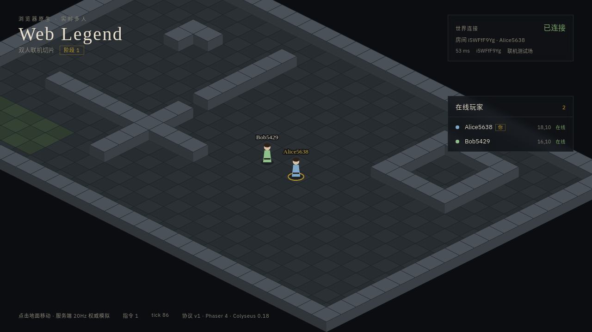
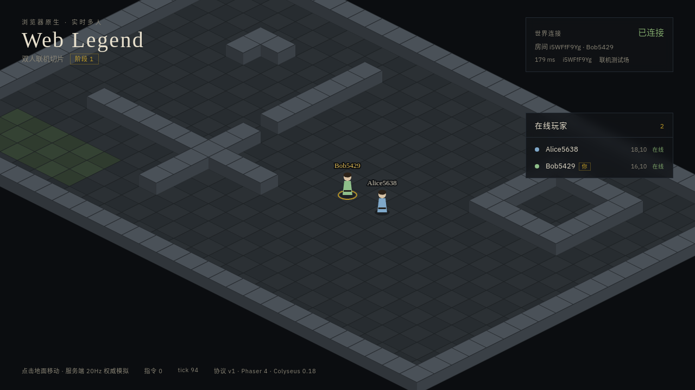
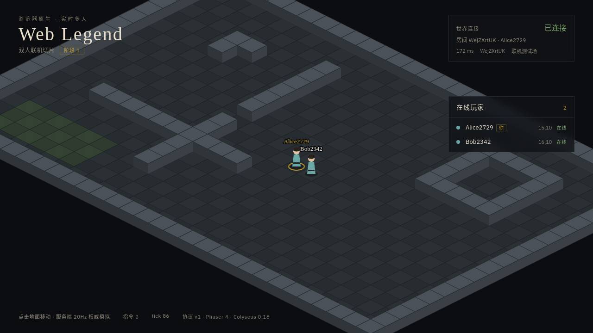

# 阶段 1 报告：浏览器双人联网垂直切片

> 日期：2026-11-24
> 状态：已完成，等待 Tech Lead 审阅
> 基线文档：`docs/WEB_LEGEND_TECHNICAL_ARCHITECTURE_v2.md`、
> `docs/WEB_LEGEND_MVP_PLAN_v2.md`
> 关联 ADR：ADR-015、ADR-016

## 1. 阶段目标与范围

在阶段 0 的可运行工程上，验证 Phaser + Colyseus + WebSocket + 浏览器渲染的真实
多人链路：

- 两个独立 Browser Context 进入同一个 `world_map` Room；
- 互相可见，点击移动由服务端权威裁定并同步；
- 客户端只能提交意图，不能伪造最终坐标；
- 断线与刷新有明确状态和可用重连；
- Phaser Scene 重启不产生重复监听。

本阶段**没有**实现正式账号、game ticket、数据库资产、Tiled 正式地图、怪物、战斗、
掉落、背包、金币、聊天、PK 或运营后台业务，也没有把假数据或空壳模块混入正式模块。

## 2. 与架构文档的一致性检查

开工前核对：

| 架构要求                 | 阶段 0 现状             | 阶段 1 处理                                        |
| ------------------------ | ----------------------- | -------------------------------------------------- |
| Room 只做适配            | diagnostics Room 仅验证 | Room 只做身份、限频、路由、同步；移动在 simulation |
| 客户端只提交意图         | 无实时消息              | `move.to` 只有目标 tile + 协议/序号/命令 ID        |
| 20Hz 模拟、10Hz 同步     | 未启用                  | 20Hz 固定步进、100ms patch                         |
| tick 不等待 IO           | 规范冻结                | `WorldSimulation.step()` 纯内存，无 await          |
| 移动使用权威导航         | 无                      | 服务端四方向 BFS + 可走性校验                      |
| 内容/地图与代码分离      | 无地图                  | 地图 JSON + Zod manifest，共用同一份数据           |
| 客户端不导入服务端包     | ESLint 边界             | 新增 game-simulation 到服务端包边界                |
| 生产不能使用开发身份     | 无身份                  | onAuth 生产一律拒绝（ADR-015）                     |
| 重连按架构 8.7           | diagnostics 已验证重连  | world Room 15s 宽限 + sessionStorage token         |
| 私有数据不得进入公开状态 | diagnostics 无私有数据  | 公开状态只有开发玩家键、显示名、位置、朝向         |

已知与架构的偏差见第 8 节。

## 3. 实际交付

### 3.1 契约

`packages/contracts/src/`：

- `map.ts`：`mapManifestSchema`、`tilePointSchema`、`isTileInsideMap`、
  `isTileWalkable`、`tileCharAt`。
- `realtime.ts`：
  - `moveToCommandSchema`（`.strict()`，只有意图字段）；
  - `commandAckSchema`（服务端路径、速度、起始位置、`deduplicated`）；
  - `commandRejectedSchema`、`commandRejectionCodeSchema`、中文错误消息；
  - `systemNoticeSchema`；
  - `worldJoinOptionsSchema`（`.strict()` 开发身份）；
  - `WORLD_ROOM_NAME`、`CLIENT_MESSAGES`、`SERVER_MESSAGES`、`FACING`、
    `TILE_UNITS=1000`、`PLAYER_SPEED_UNITS_PER_SECOND=4000`、
    `DEFAULT_TICK_HZ=20`、`DEFAULT_PATCH_RATE_MS=100`。
- `worldState.ts`：`WorldState` / `PlayerState` schema，通过
  `@web-legend/contracts/world-state` 导出。

### 3.2 模拟包

新包 `packages/game-simulation/`：

- `createFixedStepRunner`：累积 delta、固定 50ms 步长、默认最多 5 次追赶。
- `findPath`：四方向、确定性 BFS，返回 `from` 之后、包含目标的 tile 中心序列。
- `WorldSimulation`：
  - 整数子格坐标（`TILE_UNITS=1000`）；
  - 速度推进、朝向、`moving`；
  - 中途重定向时先回到当前格中心，保证路径轴对齐、不切角；
  - 出生点与路径节点必须可走；
  - 无任何 IO、网络、Colyseus 或 Phaser 依赖。

### 3.3 服务端

`apps/game-server/src/`：

- `rooms/worldMapRoom.ts`：
  - `onCreate`：加载并校验测试地图，注册指标，20Hz 模拟、100ms patch；
  - `onAuth`：生产拒绝；严格解析 join options；协议版本；同 playerKey 单连接；
  - `onJoin`：选择空闲出生点，创建 schema 玩家，会话记录；
  - `onLeave`：主动离开立即移除；掉线标记 disconnected、清路径、15s 宽限，
    超时移除；
  - `onReconnect`：恢复 connected；
  - `move.to`：幂等 → 序号 → 限频 → 会话 → 边界/可走性 → 服务端寻路 →
    设置路径 → ack；失败发送结构化 rejected；
  - 每 tick 同步位置、朝向、moving、serverTick；记录 tick 耗时。
- `world/rateLimiter.ts`：可注入时间的令牌桶（容量 10、10 次/秒）。
- `world/mapLoader.ts`：与客户端相同的 JSON，Zod 校验。
- `metrics.ts`：每房间 240 样本滑动窗口，p50/p95/p99/max、命令接受/拒绝与拒绝码；
  registry 汇总活跃房间和已销毁房间总量。
- `server.ts`：注册 `world_map`，`/metrics`，WebSocket `maxPayload=4096`；
  非生产环境保留 diagnostics。

### 3.4 客户端

`apps/game-web/src/`：

- `game/projection.ts`：伪等距投影与逆投影（纯函数，含单元测试）。
- `game/WorldScene.ts`：
  - 地面/墙/草地绘制，墙体按脚底深度参与 Y 排序；
  - 玩家为脚底锚点容器（阴影、角色、名字），自身金环；
  - 摄像机跟随、bounds、resize 处理；
  - 点击 → 屏幕坐标反投影 → tile → 可走性检查 → `move.to` 意图；
  - 本地沿 ack 路径预测；快照偏差 >900 单位吸附；远端插值；
  - 路径点提示、点击标记、无效点击红环；
  - shutdown 清理 pointerdown、resize 监听并 detach bridge。
- `game/worldBridge.ts`：网络/会话与 Scene 生命周期解耦，Scene 重启后重放最新快照。
- `net/worldClient.ts`：
  - `@colyseus/sdk` 连接，优先 sessionStorage reconnection token，失败后
    joinOrCreate / create / joinById；
  - 状态快照、ack、rejected、延迟、房间号、连接状态；
  - `room.reconnection.minUptime = 0`；
  - 主动离开时清除 token；掉线显示 reconnecting。
- `session/useWorldSession.ts`：
  - 延迟 0ms 启动，规避 StrictMode 双连接/双 Phaser；
  - React 状态：连接、玩家、自身、延迟、指令数、tick、房间、拒绝提示；
  - 开发调试钩子：点击 tile 的屏幕坐标、Scene 代数、强制断线、主动离开。
- `App.tsx` + `styles.css`：深色克制的 HUD、在线列表、状态、坐标、指令数、提示。
- `lib/identity.ts`：开发身份、sessionStorage、Room 选择（仅 DEV）。

### 3.5 地图

`content/maps/phase1_test_map.json`：30×20，边界墙、柱体、草地、封闭房间；
`spawnPoints` 8 个。客户端和服务端加载同一文件并用 `mapManifestSchema` 校验。
封闭房间用于证明不可达目标被服务端拒绝。

## 4. 测试与证据

### 4.1 命令与结果

```bash
pnpm format:check   # All matched files use Prettier code style!
pnpm lint           # 0 error / 0 warning
pnpm typecheck      # 根配置 + 10 个 workspace
pnpm test           # 21 files / 94 tests passed (约 3.0s)
pnpm build          # 4 个应用全部成功
```

E2E（本机已有旧开发栈占用 84–87，新栈运行在 8844–8847）：

```bash
GAME_WEB_PORT=8844 ADMIN_WEB_PORT=8845 GAME_SERVER_PORT=8847 \
  PLAYWRIGHT_SKIP_WEBSERVER=true pnpm test:e2e
# 6 passed (约 23s)
```

标准环境直接运行 `pnpm test:e2e`，Playwright 会自动启动 game-web、admin-web、
game-server。

### 4.2 测试覆盖

| 层      | 文件                                                 | 覆盖                                                                         |
| ------- | ---------------------------------------------------- | ---------------------------------------------------------------------------- |
| Unit    | `contracts/map.test.ts`                              | manifest 合法/行宽/字符/出生点、可走性                                       |
| Unit    | `contracts/realtime.test.ts`                         | 意图字段、伪造坐标、协议、序号、身份额外字段、ack/rejected                   |
| Unit    | `contracts/worldState.test.ts`                       | schema 实例、玩家映射、协议常量                                              |
| Unit    | `game-simulation/pathfinding.test.ts`                | 直路、绕墙、封闭区、越界、确定性                                             |
| Unit    | `game-simulation/fixedStep.test.ts`                  | 累积、抖动、追赶上限、非法输入                                               |
| Unit    | `game-simulation/simulation.test.ts`                 | 速度、终点、阻挡、重定向、确定性、清除路径、重复玩家                         |
| Unit    | `game-server/metrics.test.ts`、`rateLimiter.test.ts` | 百分位、计数、令牌桶                                                         |
| Integr. | `game-server/world.integration.test.ts`              | 双客户端可见、250ms、伪造/协议/墙体/封闭区拒绝、幂等、限频、重连、移除、指标 |
| Integr. | `game-server/production.integration.test.ts`         | 生产拒绝开发身份、无 diagnostics Room                                        |
| Unit    | `game-web/projection.test.ts`                        | 投影往返、边界、方向步长、分数位置                                           |
| E2E     | `tests/e2e/foundation.spec.ts`                       | 游戏页/管理后台真实加载                                                      |
| E2E     | `tests/e2e/multiplayer.spec.ts`                      | 双 Context、250ms、刷新重连、断线恢复、Scene 重启                            |

### 4.3 双浏览器可见性

浏览器内计时：A 的 `pointerdown` 时间戳到 B 的 DOM MutationObserver 观察到变化。
Node 侧 Playwright IPC 不计入预算。

| 运行方式        | 延迟                      |
| --------------- | ------------------------- |
| 完整套件第 1 次 | 137ms                     |
| 完整套件第 2 次 | 204ms                     |
| 单独运行 5 次   | 145、179、180、152、136ms |

全部低于阶段门禁 250ms。日志见 `docs/phase-reports/phase-01/websocket.log`。

### 4.4 实时指标

2 名玩家、52 个 tick 样本（测试服务器运行中采集）：

```json
{
  "roomId": "wZNbPdl2N",
  "players": 2,
  "acceptedCommands": 2,
  "rejectedCommands": 0,
  "tick": {
    "samples": 52,
    "p50Ms": 0.02,
    "p95Ms": 0.03,
    "p99Ms": 0.07,
    "maxMs": 0.07
  }
}
```

阶段目标为 tick p95 < 25ms；实测远低于目标。

### 4.5 页面截图

双人同房（Alice 移动到 18,10，Bob 在 16,10）：



对方视角：



刷新重连后（并在重连后再次移动）：



### 4.6 WebSocket 证据

`docs/phase-reports/phase-01/websocket.log` 记录了：

- matchmake 连接与带 `sessionId`/`skipHandshake` 的房间 WebSocket；
- 帧大小（msgpack 二进制，无法直接展示业务字段）；
- 本次测量的可见延迟。

## 5. 阶段 1 验收检查

| 验收标准                                             | 结果 | 证据                                                                         |
| ---------------------------------------------------- | ---- | ---------------------------------------------------------------------------- |
| 两个独立 Chrome Browser Context 进入同一 `world_map` | 通过 | E2E 双 Context，玩家列表 2 人                                                |
| A 移动后 B 在 250ms 内看到状态变化                   | 通过 | 浏览器内计时 136–204ms                                                       |
| 客户端伪造最终位置/速度/非法坐标被拒绝               | 通过 | 集成测试：额外 x/y → INVALID_PAYLOAD；墙/封闭区 → INVALID_TARGET/UNREACHABLE |
| 页面刷新/断网有明确状态且可重连                      | 通过 | E2E 刷新重连不重复玩家；断开显示 reconnecting 后恢复                         |
| Phaser Scene 重启不产生重复事件和输入监听            | 通过 | E2E：重启后一次点击只发送 1 条指令                                           |
| 20Hz 模拟、约 10Hz patch 可观测                      | 通过 | state.tickHz=20、patchRate=100ms；指标 tick 样本持续增长                     |
| tick p95 < 25ms                                      | 通过 | 0.03ms                                                                       |
| 无数据库/登录/背包/战斗假实现混入正式模块            | 通过 | 本阶段只有开发身份与移动；生产拒绝开发身份                                   |
| lint / typecheck / test / build / E2E 全部通过       | 通过 | 见第 4.1 节                                                                  |
| 阶段报告含截图、WebSocket 日志和真实结果             | 通过 | 本文件与 `phase-01/`                                                         |

## 6. 安全性检查

- 生产 `onAuth` 无条件拒绝开发身份（测试验证 525）。
- join options 与所有实时命令均使用 Zod `.strict()`；额外字段被拒绝。
- `move.to` 不接受坐标、速度、传送字段；服务端重新寻路。
- 命令限频（令牌桶）、`commandId` 幂等、序号过期拒绝。
- WebSocket payload 上限 4KB。
- 公开状态不含账号、令牌、背包或 GM 标志。
- 重连 token 只存 `sessionStorage`，不使用 `localStorage`。
- 客户端不导入服务端包；新增 `game-simulation` 边界规则。

## 7. 与基线的偏差及理由

1. **技术测试地图而非 Tiled 正式地图**：Tiled、导航网格、map-runtime 属阶段 3。
   本阶段使用共享 JSON manifest，明确标注为技术资产（ADR-016）。
2. **地图 manifest schema 暂放 contracts**：`map-runtime` 按 ADR-013 在阶段 3 创建；
   当前 schema 有真实消费者（客户端 + 服务端）和测试。
3. **开发身份**：阶段 2 才有正式账号；本阶段严格限制在 development/test，
   生产拒绝（ADR-015）。
4. **浏览器通过同源 `/ws`**：开发环境由 Vite 代理，避免把游戏服端口暴露给浏览器；
   生产反代需配置相同路由。
5. **位置不持久化**：阶段 1 只验证实时链路；checkpoint 与资产持久化在阶段 3/5。
6. **E2E 使用 DEV 参数 `?fresh/?join`**：隔离测试房间。生产构建忽略这些参数。
7. **验证端口 8844–8847**：本机旧开发栈占用 84–87，无法在本会话安全重启；
   同一套代码用等价端口完成验证，默认配置未改。

## 8. ADR 实施状态

| ADR                        | 阶段 1 实施情况                                               |
| -------------------------- | ------------------------------------------------------------- |
| ADR-001 Phaser 4 / 2D      | 伪等距技术场景、脚底锚点、Y 排序                              |
| ADR-002 React + Phaser     | React HUD + Phaser canvas 共存                                |
| ADR-003 Room per Map       | `world_map` Room 承载一个地图实例                             |
| ADR-004 服务端权威         | 位置、路径、速度、朝向均由服务端决定                          |
| ADR-005 PostgreSQL 事实源  | 本阶段无持久资产；数据库未参与移动                            |
| ADR-006 Redis 后置         | 未使用                                                        |
| ADR-007 模块化单体         | 新增 game-simulation 纯包；Room 只做适配                      |
| ADR-008 固定 Room 内容版本 | 本阶段 Room 固定地图 manifest；Content Release 在阶段 7       |
| ADR-009 事务 / tick 隔离   | 模拟无 IO；本阶段无资产事务                                   |
| ADR-010 不做完整 ES        | 未引入事件存储                                                |
| ADR-011 Effect DSL         | 未涉及                                                        |
| ADR-012 AI Ops 后置        | 未涉及                                                        |
| ADR-013 按消费者建包       | 创建 game-simulation；其余包继续延后                          |
| ADR-014 工具链锁定         | 未升级依赖；`@colyseus/sdk` 与 contracts 的 schema 版本已锁定 |
| ADR-015 开发身份           | 已实现并测试生产拒绝                                          |
| ADR-016 移动模型           | 已实现并测试                                                  |

## 9. 已知风险与限制

- 技术地图、墙体和角色是占位资产，不代表最终美术与手感；阶段 3 做正式资源管线。
- 250ms 目标在本容器接近上限（最差 204ms）；后续若持续超标，先查 patch 相位和
  渲染调度，再考虑调整同步频率，不降低断言。
- 单图 30/50 人容量未实测；阶段 8 负责压测和指标。
- 位置只在内存；Game Server 崩溃会丢失移动进度（角色重新进入出生点）。
- `joinOrCreate` 会加入任意可用房间；开发测试用显式房间参数隔离，正式房间选择
  与玩家分配在阶段 2/3 设计。
- 指标为进程内窗口，未接 Prometheus。
- 当前主机旧开发栈需用户重启后才能在 84–87 看到阶段 1 页面。
- 独立测试数据库、CI 真实 Runner 执行仍待后续阶段。

## 10. 阶段 2 建议任务清单

**A. 契约与 schema（Architect）**

1. Account、AccountSession、Realm、Character、CharacterSession 表与迁移。
2. 注册/登录/刷新/登出、角色创建/列表、`game/ticket` 的 REST 契约与错误码。
3. 角色名归一化与 Realm 内唯一约束；职业与初始属性内容常量。
4. Ticket 结构：accountId、characterId、realmId、nonce、issuedAt、expiresAt，
   一次性消费。

**B. 认证与持久化（Platform / Domain）**

5. Argon2id 密码哈希；refresh token hash 与轮换；会话撤销。
6. 角色创建事务；初始地图/出生点；角色读取与所有权检查。
7. Ticket 签发、消费与过期；PostgreSQL 事务/唯一约束保证一次性。

**C. 实时服务器（Server）**

8. `onAuth` 改为校验 ticket，删除开发身份分支；保留测试替身但生产不可用。
9. 单角色活跃会话 lease：重复登录策略（替换或拒绝）并测试。
10. 角色加载/恢复：Room 加入时从 PostgreSQL 读取角色位置与基础属性。
11. 断线/崩溃后的重新入图流程。

**D. 客户端（Client）**

12. 注册/登录/角色列表/创建角色/进入游戏页面。
13. 从 Control API 获取 ticket，再连接 Room；票据失败状态。
14. 保留现有移动与 HUD，替换开发身份来源。

**E. 测试与证据（QA）**

15. 集成测试：未登录不能进正式 Room；过期/撤销/重复 ticket 拒绝；同名角色拒绝；
    同一角色不能被两端同时控制；API/DB 重启后角色仍可读取。
16. E2E：注册 → 登录 → 创建角色 → 进图 → 两个 Context 可见。
17. 更新 ADR-015 为 Superseded（或记录退出条件完成）。

### 自查修复

阶段报告初稿完成后的自查发现并修复了一个重连缺陷：刷新后新客户端从
`clientSequence=0` 开始，而 Room 保留刷新前序号，首条移动会被 `STALE_SEQUENCE`
拒绝。修复为 `onReconnect` 重置会话序号与幂等窗口；集成测试和 E2E 刷新场景均
增加“重连后再次移动”断言。修复提交：`954155f`。

## 11. 审阅门禁

阶段 1 已完成并在此停止。未收到 Tech Lead 明确批准前，不开始阶段 2，不扩大阶段 1
范围，不跳过阶段门禁。

## 12. Git 提交

- 阶段 1 主提交：`e6574057308dd6bfe5c9f99d4b06d24a5ee00236`
  `feat(phase-1): deliver browser two-player realtime slice`。
- 阶段 1 修复提交：`954155f`
  `fix(phase-1): reset the command sequence when a client reconnects`。
- 本文档的补记提交可通过 `git log --oneline` 查看。
